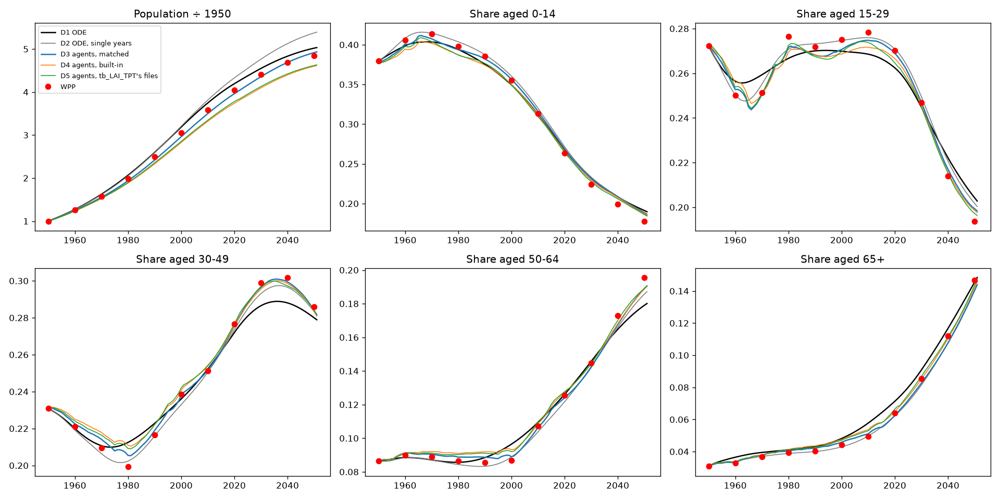
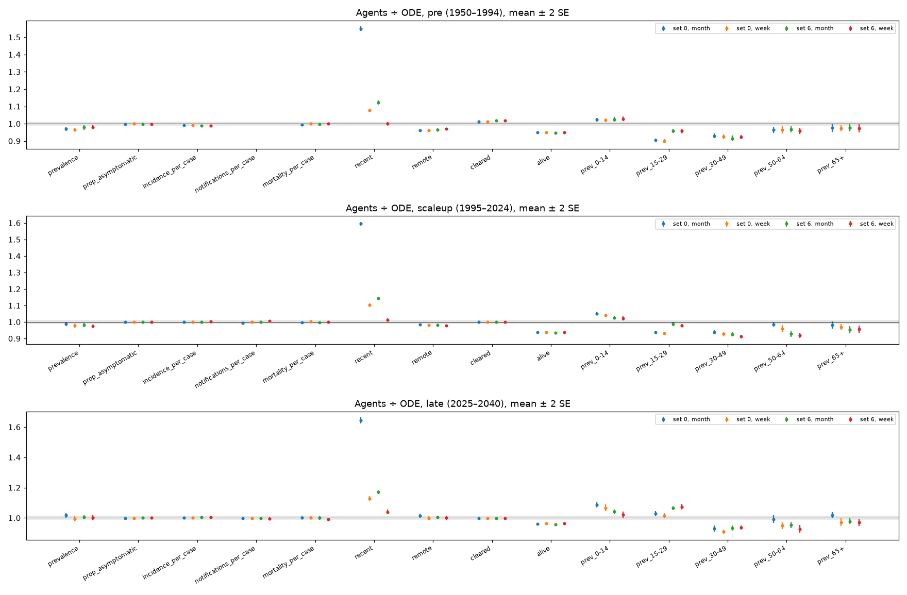
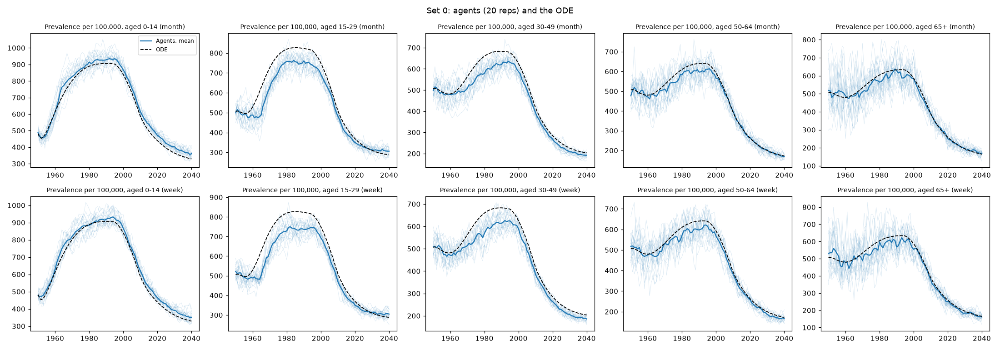
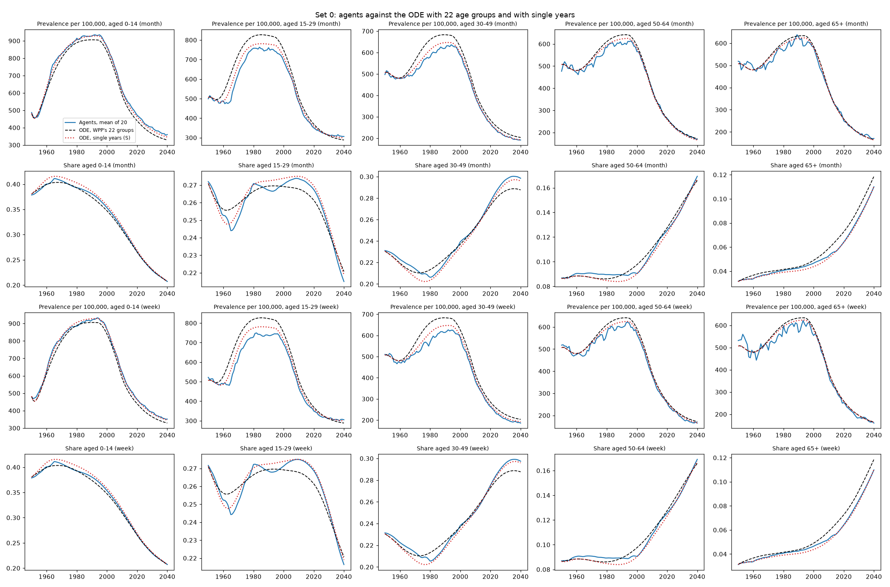
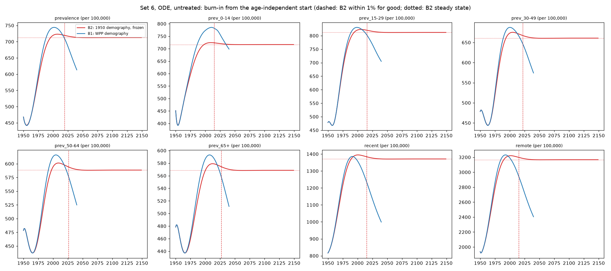
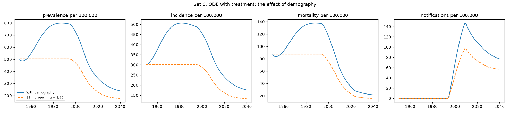

# 28: Summary

**Track:** v4 (tbsim `619c296`, starsim `d83f4f87`; `versions.json`). Run on zebra on 2026-11-12, except arm S (below), run on a laptop on 2026-11-18 with the same pins. Stage 1 was rerun there with the same seeds after a fix to its realized-fertility calculation (exp 29); its populations are unchanged. The zebra checkout was marked dirty, but its `run.py` was identical to this folder's before arm S was added.

**Question:** with India's WPP 2024 fertility and mortality, the 1950 age distribution and a growing population, do v4's agents reproduce v4's ODE? First for demography alone (stage 1), then with exp 27's TB model and treatment (stage 2).

**Setting:**

- **Age groups:** WPP's mortality groups (0, 1–4, 5–9, …, 95–99, 100+) by sex. In the ODE, people leave each group at a constant rate of 1 ÷ its width.
- **Rates:** both solvers use WPP's rates as bundled with Starsim (every 10 years), interpolated linearly by year. Fertility applies to women aged 10–54.
- **The ODE's births and deaths:** `ss.birth` and `ss.death` by age and sex.
- **Agents' births and deaths:** `ss.Pregnancy`, given the same annual fertility table, plus the same `ss.death`.
- **Stage 1 arms** (no TB, 1950–2050, monthly steps):
  - D1: the ODE;
  - D2: the ODE with single years of age;
  - D3: agents set to match D1;
  - D4: agents with Starsim's built-in modules and defaults;
  - D5: agents with tb_LAI_TPT's annual data files.

  Agents start at 100,000 people, with 10 reps per arm.
- **Stage 2:**
  - **Model:** exp 27's (`tbode4.TBTreat`: treatment from the end of 1994, TB mortality falling over time), at sets 0 and 6 from exp 24's posterior. Set 0 front-loads progression strongly (`k_latent` = 11.1 per year) and set 6 weakly (2.4).
  - **Demography:** D1's in the ODE and D3's for agents.
  - **Start:** 1950, from the set's equilibrium without ages, the same in every age group.
  - **Agents:** 100,000 at the start (about 440,000 by 2040), 20 reps per set at monthly and weekly steps.
  - **Windows:** 1950–1994 (before treatment, while the start settles), 1995–2024 (scale-up) and 2025–2040.
- **ODE-only arms (stage 2):**
  - B1: WPP demography, no treatment;
  - B2: demography frozen at 1950's rates, no treatment, run to 2150 (its steady state measures burn-in);
  - B3: exp 27's ODE without ages (births replace deaths at μ = 1/70), with treatment.
- **Arm S (stage 2):** the main arm's ODE with single years of age (0–99, 100+), at both sets and steps, compared with the same agent runs. The rates stay on WPP's groups.

**Result:** agents ÷ ODE match within 1% for the population-wide ratios per prevalent case. They don't match for population size or the age pattern. Agents' population is 6–7% smaller from 1990 to 2010; this comes from how `ss.Pregnancy` times births, not from the ODE's aging. The ODE's aging between 5-year groups distorts its age distribution, by up to 14% in the 65+ share, so prevalence by age group differs by up to 10%. With single years of age in the ODE (arm S), prevalence by age group matches within 5% (ages 30–49 within 3%), at about 8% more run time. Prevalence over all ages is 1–3% low in agents before 2025, then within 1.3%. The high recent latent infection is fully explained by end-of-step snapshots (exp 21). Demography also raises the ODE's burden by 35–60%, and its burn-in from an age-independent start takes 33–77 years.

## Finding 1: agents' population grows more slowly than the ODE's, because of when `ss.Pregnancy` delivers

| Population ÷ 1950 value, ratio between arms (agents: mean of 10 reps; SE ≤ 0.3% of each ratio) | 1960 | 1980 | 2000 | 2020 | 2050 |
|---|---|---|---|---|---|
| D1 (ODE) ÷ WPP | 1.010 | 1.041 | 1.043 | 1.035 | 1.035 |
| D2 (ODE, single years) ÷ D1 | 0.999 | 0.992 | 1.006 | 1.032 | 1.070 |
| D3 (agents, matched) ÷ D1 | 0.979 | 0.938 | **0.930** | 0.945 | 0.979 |
| D3 ÷ D2 | 0.980 | 0.945 | 0.924 | 0.915 | 0.915 |
| D4 (agents, Starsim's defaults) ÷ D3 | 0.988 | 0.973 | 0.955 | 0.944 | 0.935 |
| D5 (tb_LAI_TPT's files) ÷ D4 | 1.006 | 1.006 | 1.009 | 1.011 | 1.004 |

- **D3 misses the 1% criterion:** its population is 7% below D1's by 2000, and 2% below by 2050.
- **The ODE's aging isn't the cause.** D2, with single years of age, ages people much more closely, though not exactly: finer groups take about another 2% off its population by 2000 (exp 29). Its age shares match the agents' (Finding 2), but its population is further from the agents' than D1's is (D3 ÷ D2 = 0.915 from 2020). D1 comes closer because its aging spreads people into older, higher-mortality ages, which slows its growth. That offsets part of the agents' gap by chance.
- **The cause is the births.** Agents' crude birth rate is 12% below D2's in 1950 and 3–5% below it from 1960 to 2000 (`demog.log`). Their total fertility realized from deliveries is 1.00 of the input from 1960 on (0.92 in 1950). But deliveries come at older ages: ages 15–24 get 0.80–0.93 of the input rate, and ages 35–49 get 1.0–2.8 of it.
- **How `ss.Pregnancy` produces this:** it applies the fertility rate to a woman's age at conception and delivers 32–42 weeks later. It rescales the rate to women who aren't already pregnant, and a fetus is lost if its mother dies. Births come about 0.75 years later in a mother's life than in the ODE, which lengthens each generation.
- **The full account** ([exp 29](../29_pregnancy_timing/SUMMARY.md)) of D3's 7.5% gap to D2 in 2000:
  - 3.3% is the age at which `ss.Pregnancy` applies fertility, fixed by shifting the rates younger by its mean gestation;
  - 0.5% is too few women pregnant at the start, fixed by overriding `ss.Pregnancy`'s `burnin_plan()`;
  - 1.9% is the ODE's start: Starsim's compartmental solver starts with half of each age women, where WPP's 1950 population for India has 48.6%. Every ODE run here, D1 and D2 and stage 2's, starts that way;
  - 2.2% is D2's own aging error.
  With all four dealt with, agents match the ODE within 0.1%.
- **Against WPP,** the agents (D3) come closer than the ODE: 0.97 of WPP in 2000 and 1.01 in 2050. WPP includes net migration, which both models leave out.
- **Starsim's defaults (D4) cost another 5–6% of population** by 2050, from ignoring fertility under 15 and using the nearest decade's rates. tb_LAI_TPT's annual files (D5) change population by under 1.1%.
- **Input check:** the interpolated bundled rates agree with tb_LAI_TPT's annual files at each decade. In between, interpolation differs by up to 0.18 in total fertility (ages 15–49) and up to 3.4 years in life expectancy at birth (1965; `inputs.log`, `inputs.png`).

## Finding 2: the ODE's aging between 5-year groups distorts its age distribution

| Share of population (stage 1; agents: mean of 10 reps) | D1 (ODE) | D2 (ODE, single years) | D3 (agents) | WPP |
|---|---|---|---|---|
| 65+, 2020 | **0.071** | 0.062 | 0.063 | 0.064 |
| 50–64, 2000 | **0.097** | 0.089 | 0.089 | 0.087 |
| 30–49, 2040 | **0.288** | 0.297 | 0.299 | 0.302 |
| 15–29, 2050 | **0.204** | 0.202 | 0.199 | 0.194 |

- **Why:** the ODE's constant exit rate makes time in each group exponential. A cohort's model ages therefore spread out: a cohort born together has model ages with an SD of 15.5 years at 50 years old, and 17.2 at 75 (`demog.log`). People reach old age too early, so D1 overstates the 65+ share by 10–14% from 2010 to 2030.
- **With single years (D2)** the shares match the agents' to within about 3%.
- **The same distortion appears in the TB runs.** Agents ÷ ODE for the 65+ share is 0.90–0.97, and for 50–64 it is 0.97–1.02 (`by_window.csv`).

## Finding 3: with TB, ratios per prevalent case match; prevalence by age matches only with single years of age

| Agents ÷ ODE (1.00 = match), mean ± SE over 20 reps | Set 0, monthly | Set 0, weekly | Set 6, monthly | Set 6, weekly |
|---|---|---|---|---|
| Prevalence, 1950–1994 | 0.969 ± 0.005 | 0.966 ± 0.005 | 0.978 ± 0.007 | 0.980 ± 0.006 |
| Prevalence, 1995–2024 | 0.989 ± 0.005 | 0.978 ± 0.006 | 0.982 ± 0.006 | 0.975 ± 0.005 |
| Prevalence, 2025–2040 | 1.018 ± 0.008 | 0.996 ± 0.007 | 1.005 ± 0.006 | 1.001 ± 0.009 |
| Share asymptomatic, all windows | 0.997–1.000 | 0.999 | 0.998–1.000 | 0.998–1.001 |
| Incidence per prevalent case, 1950–1994 | 0.990 ± 0.001 | 0.992 ± 0.001 | 0.988 ± 0.001 | 0.989 ± 0.001 |
| Incidence per prevalent case, 1995–2040 | 0.999–1.000 | 1.001 | 1.002–1.004 | 1.002–1.006 |
| Notifications per prevalent case, 1995–2040 | 0.995–0.998 | 0.999–1.001 | 0.999 | 0.994–1.005 |
| TB mortality per prevalent case, all windows | 0.995–1.001 | 1.001–1.003 | 0.996–1.001 | 0.992–1.001 |
| Population (`alive`), all windows | 0.937–0.962 | 0.938–0.963 | 0.934–0.959 | 0.938–0.964 |
| Prevalence aged 0–14, all windows | 1.02–1.09 | 1.02–1.07 | 1.03–1.04 | 1.02–1.03 |
| Prevalence aged 15–29, all windows | 0.91–1.03 | 0.90–1.02 | 0.96–1.06 | 0.96–1.07 |
| Prevalence aged 30–49, all windows | 0.93–0.94 | 0.91–0.93 | 0.92–0.93 | 0.91–0.94 |

- **Per prevalent case, the models match:** incidence, notifications, the number on treatment and TB mortality are within 0.8% after 1995. Incidence per case is 1% low before 1995.
- **Prevalence over all ages is 2–3% low in agents before 2025,** which is 4–5 SE at weekly steps over 1995–2024. So it misses the design's criterion in that window. From 2025 it's within 2%.
- **By age the gaps are larger and systematic:**
  - ages 30–49 are 6–9% low in every window, set and step;
  - ages 15–29 are 1–10% low before 2025, most in set 0;
  - children are 2–9% high.

  Both solvers use the same TB rates at every age, so the gaps come from how people and their TB states move between age groups. Arm S confirms that most of it is the ODE's aging between 5-year groups (Finding 2; table below).
- **The pre-1995 shortfalls** in prevalence (2–3%), remote latent infection (3–4%) and incidence per case (1%) all fall during the settling from the age-independent start (Finding 5). The cleared share is 1–2% high over the same years. These haven't been separated from the age effects.
- **Treatment pitfall checks** are as in exp 27 (`pitfall_checks.csv`, 299,000–314,000 courses per arm):
  - at monthly steps, 7–12 starts while on treatment and 4–5 TB deaths on courses that will cure; at weekly steps, 0–1;
  - courses last exactly 6 steps monthly, and 26.1 weeks on average weekly;
  - nobody starts treatment unless symptomatic, and nobody relapses without a cure;
  - `restart_same_step` counts a failure followed by a new start within the same step, which the design allows.

**With single years of age in the ODE (arm S):**

| Agents ÷ ODE (1.00 = match), range of means over 2 sets × 2 steps × 3 windows (SE 0.001–0.013) | ODE with WPP's 22 groups | ODE with single years (S) |
|---|---|---|
| Prevalence, all ages | 0.966–1.018 | 0.977–1.013 |
| Prevalence, all ages, 1950–1994 | 0.966–0.980 | 0.977–0.988 |
| Prevalence aged 0–14 | 1.02–1.09 | 1.00–1.03 |
| Prevalence aged 15–29 | 0.90–1.07 | 0.95–1.03 |
| Prevalence aged 30–49 | 0.91–0.94 | 0.97–0.99 |
| Prevalence aged 50–64 | 0.92–0.99 | 0.97–1.02 |
| Prevalence aged 65+ | 0.95–1.02 | 0.98–1.02 |
| Share of population aged 65+ | 0.90–0.97 | 1.01–1.03 |
| Population (`alive`) | 0.93–0.96 | 0.91–0.95 |
| Incidence per prevalent case | 0.988–1.006 | 0.990–1.003 |

- **Single years remove most of the age pattern.** Ages 30–49 go from 6–9% low to 1–3% low, and children from up to 9% high to at most 3% high (`by_window_single.csv`, `agents_vs_ode_single.png`). The ratios per prevalent case are unchanged to within 0.3% (`single_vs_groups.csv`).
- **What's left lines up with Finding 1.** Agents' population is now 5–9% smaller than the ODE's, with fewer children (0.98–0.99 of the share) and more people aged 50 and over (1.00–1.04). Agents' younger cohorts are smaller because their births come later. Ages 15–29 before 1995 are still 2–5% low. That hasn't been separated from the births.
- **Prevalence over all ages before 1995 is still 1–2% low.**
- **Cost:** S takes 4.0–4.3 s at monthly steps and 22–23 s at weekly, against 3.6–4.8 s and 21–24 s with 22 groups (`single.log`; one core). Starsim keeps results by group at every step only while they take at most 100 MB in a run. S at weekly steps takes more, so the limit was raised for it; each weekly S run then takes about 0.5 GB more memory. Monthly runs are within the limit.

## Finding 4: the high recent latent infection is the end-of-step snapshot effect

v4 dates each infection at the end of its step, so an end-of-step snapshot counts the last step's new infections in full, whereas the ODE's state averages over them. Exp 21 showed the excess is x / (1 − e^(−x)), where x is the rate of leaving recent latent infection (`inf_cle` + `inf_non` + `inf_asy` + `k_latent`) × `dt`.

| Recent latent, agents ÷ ODE (mean of 20 reps), 1995–2024 | Set 0, monthly | Set 0, weekly | Set 6, monthly | Set 6, weekly |
|---|---|---|---|---|
| Rate of leaving recent latent infection, per year | 12.59 | 12.59 | 3.70 | 3.70 |
| Predicted snapshot excess | 1.615 | 1.126 | 1.162 | 1.036 |
| Observed | 1.595 | 1.104 | 1.143 | 1.013 |
| Observed ÷ predicted | 0.988 | 0.981 | 0.983 | 0.978 |
| Remote latent, for comparison | 0.986 | 0.981 | 0.982 | 0.978 |

- **In every window, set and step,** observed ÷ predicted equals agents ÷ ODE for remote latent infection to within 0.003. It's within 0.014 of all-age prevalence too. What's left is the same small shortfall seen in prevalence, not a separate mismatch.
- **The excess is the same as exp 27's for the same sets** (set 0: 1.60–1.62 monthly, 1.12–1.13 weekly; set 6: 1.15–1.17 and 1.03–1.04). It's larger for set 0 because faster front-loading makes recent infections shorter-lived.

## Finding 5: from an age-independent start, the ODE takes decades to settle

| B2 (1950 demography frozen, untreated): first year after which each output stays within 1% of its steady state | Set 0 | Set 6 |
|---|---|---|
| Prevalence, all ages | 1983 | 2019 |
| Prevalence by age group | 1981–1989 | 2015–2027 |
| Recent / remote latent infection | 1978 / 1979 | 2015 / 2015 |
| Incidence / TB mortality | 1979 / 1984 | 2016 / 2020 |
| Age shares of the population | 1953–1990 | 1953–1990 |

- **The start isn't close to the steady state with ages.** Prevalence first dips (to about 440/100k in set 6), then overshoots to about 720, against a start of about 470 (figure above).
- **Set 6 takes about 70 years to settle,** past the targets' years (2015–2020). Set 0 takes about 35. So a 1950 start without ages isn't long enough for every set; a starting state with ages, or an earlier start, is needed.
- **Demographic change (B1 ÷ B2) moves prevalence by 1–4% up to 1994,** then by much more: by 2040, set 0 is 0.75 and set 6 is 0.86 (`burnin.log`).

## Finding 6: demography raises the ODE's burden at these parameters

| With demography ÷ B3 (no ages, μ = 1/70), ODE, means over each window | Set 0, 1950–1994 | 1995–2024 | 2025–2040 | Set 6, 1950–1994 | 1995–2024 | 2025–2040 |
|---|---|---|---|---|---|---|
| Prevalence | 1.35 | 1.53 | 1.41 | 1.21 | 1.57 | 1.61 |
| Incidence | 1.47 | 1.55 | 1.39 | 1.35 | 1.63 | 1.60 |
| TB mortality | 1.33 | 1.53 | 1.42 | 1.19 | 1.57 | 1.61 |
| Notifications | – | 1.51 | 1.42 | – | 1.58 | 1.61 |

Both start from the same state in 1950. Exp 24's calibration fitted the targets without demography, so it will need redoing with demography. This experiment doesn't isolate which part of demography (shorter lives, a younger population, growth) raises the burden.

## What this means

- **Consistency table, age-specific fertility/mortality row:** ⚠️.
  - The TB natural history and treatment carry over: the ratios per prevalent case match within 1% after 1995.
  - The population doesn't, by up to 7% in size, from `ss.Pregnancy`'s gestation.
  - The age pattern doesn't either with WPP's 5-year groups in the ODE, by up to 14% in age shares and 10% in prevalence by age. With single years of age it matches within 5%, and within 3% from age 30, at little extra cost.
  - Prevalence over all ages is 1–3% low in agents before 2025.
- **For an ODE matched to agents with demography:** use single years of age in the ODE. Then test births in agents timed as in the ODE, or the ODE's births delayed by gestation.
- **Burn-in:** starting in 1950 from an age-independent state isn't enough for slow-progression sets such as set 6.
- **The ODE runs in about 4 seconds at monthly steps,** with WPP's groups or with single years.

## Next

- **Isolate the population gap:** done in [exp 29](../29_pregnancy_timing/SUMMARY.md).
- **A starting state with ages** (the ODE's steady state with 1950's demography, B2 at 2150), handed to agents, to remove the long settling.
- Then the next row: no transmission under age 10.

## Files

- `inputs.csv`, `inputs.log`, `inputs.png`: the input check.
- `demog.obj`, `demog.csv`, `demog.log`, `demog_population.png`, `demog_pyramids.png`, `demog_rates.png`, `stage1.out`: stage 1.
- `ode.obj`, `runs.obj`, `runs_by_group/`, `by_window.csv`, `pitfall_checks.csv`, `tb.log`, `tb.out`: stage 2. Figures: `tb_burden_<set>.png`, `tb_prev_by_age_<set>.png`, `tb_population_<set>.png`, `agents_vs_ode.png`.
- `burnin.obj`, `burnin_times.csv`, `burnin.log`, `burnin.out`, `burnin_<set>.png`, `demog_effect_<set>.png`: the ODE-only arms.
- `ode_single.obj`, `by_window_single.csv`, `single_vs_groups.csv`, `single.log`, `single.out`, `single_by_age_<set>.png`, `agents_vs_ode_single.png`: arm S.
- `quick/`: small test runs made before the design; not used here.
