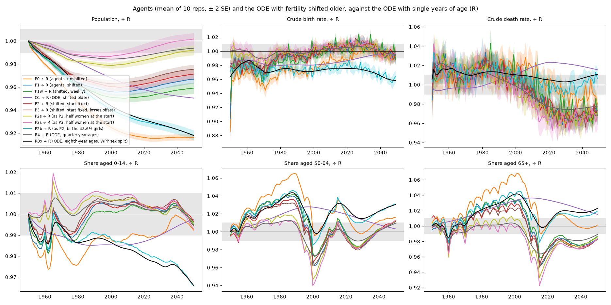
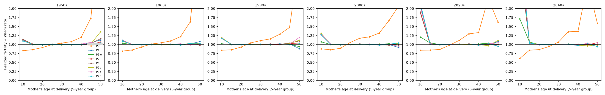
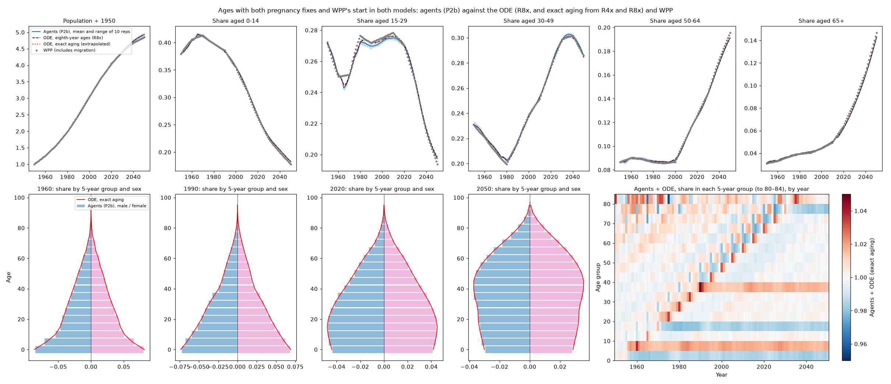
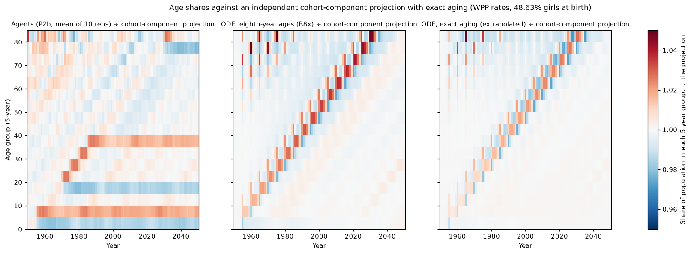

# 29: Summary

**Track:** v4 (tbsim `619c296`, starsim `d83f4f87`; `versions.json`). Run on a laptop on 2026-11-18.

**Question:** exp 28 found agents' population growing more slowly than the ODE's with India's WPP fertility and mortality: 0.925 of the ODE's by 2000, with the ODE split by single years of age. Why, and what makes the two match?

**Setting:** demography only (no TB), India 1950–2050, WPP 2024 rates as bundled with Starsim and interpolated by year, deaths by age and sex in every arm. Agents: 10 reps of 100,000 at the start (about 500,000 by 2050), monthly steps.

| Arm | Solver | What it is |
|---|---|---|
| R | ODE, single years of age | The reference: births at WPP's rate for each woman's current age (WPP's rates are by age at delivery) |
| R2, R4, R8 | ODE, half-, quarter- and eighth-year age groups | As R, with finer age groups: is R's aging converged? |
| O1 | ODE, single years of age | Fertility shifted 0.77 years older: births later in life, without pregnancy |
| P0 | Agents | `ss.Pregnancy` as in exp 28: WPP's rates applied at the age at conception |
| P1 | Agents | Fix 1: fertility shifted younger by the mean gestation (0.769 years) |
| P1w | Agents | P1 at weekly steps |
| P2 | Agents | P1 + fix 2: the steady-state share of women pregnant at the simulation's start |
| P3 | Agents | P2 + conception raised to offset pregnancies lost when the mother dies |
| P2s, P3s | Agents | P2 and P3 starting with half of each age women, as the ODE does (diagnostic) |
| R4x, R8x | ODE, quarter- and eighth-year age groups | As R4 and R8, started from WPP's 1950 split by sex within each age group |
| P2b | Agents | P2 with births 48.63% girls, as R4x's and R8x's (their starting female share; see Finding 3) |

The arms were added in rounds as the gap was taken apart: R to O1 first, then R2 and R4, then P2, P3 and R8, then P3s and P2s, and last the fix to the ODE's start (R4x, R8x, P2b). Earlier arms kept their seeds.

**Result:** the whole gap is explained, by four things, and fixed:

| Part of P0's 7.5% gap to R in 2000 | Size | Where it is |
|---|---|---|
| Fertility applied at the age at conception, not delivery | 3.3% | `ss.Pregnancy` (fix 1) |
| Too few women pregnant at the simulation's start | 0.5% | `ss.Pregnancy` (fix 2) |
| The ODE starts with 50.0% women; WPP's 1950 population has 48.6% | 1.9% | Starsim's compartmental solver (fixed with a joint split by age and sex) |
| Single years of age don't age people exactly | 2.2% | The ODE's age groups |

The four together predict P0 ÷ R = 0.925, as measured.

- **With fixes 1 and 2 in agents, and the same start in both models,** agents are within about 0.1% of the ODE extrapolated to exact aging, through 2050. That holds with the ODE's 50/50 start in both (P2s), and with WPP's start in both (P2b against R4x and R8x).
- **The ODE can start from WPP's split by sex and age** through `sim.stratify()`, but its births are then as female as its starting population (48.63% girls here), whatever `ss.birth`'s `p_female` says; agents need the same share.
- **Pregnancy losses at the mother's death don't need offsetting.** Births per woman alive at delivery already equal WPP's rate. Offsetting them (P3) overshoots by 0.6% of fertility.
- **Two more problems turned up in `ss.Pregnancy`'s reporting:**
  - its loss results don't count pregnancies lost when the mother dies;
  - its warning that births are made twice is a false positive.

## Finding 1: with fix 1, births come at WPP's ages

| Realized fertility ÷ WPP's rate (deliveries ÷ women, by age at delivery; mean of 10 reps over each decade) | 1950s | 1960s | 1980s | 2000s | 2020s | 2040s |
|---|---|---|---|---|---|---|
| P0, ages 15–24 | 0.86–0.91 | 0.85–0.93 | 0.85–0.93 | 0.85–0.89 | 0.84–0.86 | 0.84–0.86 |
| P0, ages 35–49 | 1.08–1.73 | 1.10–1.63 | 1.15–1.47 | 1.21–1.66 | 1.29–2.28 | 1.35–2.71 |
| P2, ages 15–44 | 0.990–1.007 | 0.995–1.004 | 0.996–1.006 | 0.992–1.010 | 0.992–1.006 | 0.996–1.039 |
| Total fertility, P0 / P2 / P3 | 0.992 / 0.999 / 1.006 | 1.000 / 1.000 / 1.006 | 1.002 / 1.004 / 1.007 | 0.999 / 1.001 / 1.003 | 1.000 / 1.000 / 1.001 | 1.000 / 1.000 / 0.998 |
| Mean age at childbearing, WPP / P0 / P2 | 28.00 / 28.81 / 27.96 | 27.76 / 28.57 / 27.75 | 26.25 / 27.06 / 26.22 | 25.87 / 26.66 / 25.86 | 27.79 / 28.58 / 27.80 | 28.76 / 29.53 / 28.77 |

- **P0's mean age at childbearing is 0.77–0.81 years too old,** the mean gestation. Its total fertility is right, so births are delayed, not missing.
- **The shift removes the delay.** The highest value for P2 (1.039, at ages 15–19 in the 2040s) is where the rate is small next to that at 20–24.
- **Ages 10–14 read 1.1–1.3 to 2000, and more later,** where WPP's 10–14 rate is tiny next to the 15–19 one. The spread of gestation (32–42 weeks) brings some conceptions at the 15–19 rate forward to deliveries before 15. Births at these ages are few.
- **Weekly steps (P1w) give the same pattern,** and 0.5–0.8% less population than P1 from 2000.
- **The size of the delay's effect is confirmed from the ODE's side.** Shifting the ODE's fertility 0.77 years older (O1) lowers its population by the same amount the shift raises agents' (R ÷ O1 against P1 ÷ P0): 1.033 against 1.034 in 2000, and 1.052 against 1.055 by 2050.
- **A bug in exp 28's realized-fertility calculation** counted girls under 10 among women aged 10–14, so it read about 0.2–0.4 for ages 10–14 and up to 1% low for total fertility. It's fixed, and exp 28's stage 1 was rerun with the same seeds; its populations are unchanged.

## Finding 2: the ODE's aging converges with finer age groups, and single years are 2.2% off

Agents age exactly. The ODE ages people by moving them between age groups at a constant rate, so the time spent in a group is random with mean equal to its width h. Reaching age a takes a/h moves, so a cohort's ages spread with variance a·h, and the error in population should be proportional to h. If so, each halving of h halves the change, and exact aging is about 2·P(h/2) − P(h).

| Population ÷ its 1950 value, ÷ R (deterministic) | 1960 | 1980 | 2000 | 2020 | 2050 |
|---|---|---|---|---|---|
| R2 (half-year groups) | 0.998 | 0.992 | 0.990 | 0.992 | 0.996 |
| R4 (quarter-year groups) | 0.996 | 0.987 | 0.984 | 0.987 | 0.994 |
| R8 (eighth-year groups) | 0.996 | 0.985 | 0.981 | 0.985 | 0.992 |
| Exact aging, extrapolated: 2·R8 − R4 | 0.995 | 0.982 | **0.979** | 0.982 | 0.991 |

- **The changes do halve.** In 2000, R − R2 is 1.0%, R2 − R4 0.55% and R4 − R8 0.29%. Extrapolating from R2 and R4 predicted R8 at 0.9815 of R in 2000, and it came out at 0.9814 (0.9925 against 0.9924 in 2050). Exact aging from R4 and R8 agrees with that from R2 and R4 to within 0.05%.
- **So R overstates population by 2.2% in 2000 (0.9% by 2050).** R2 is 1.1% and R4 0.55% above exact aging in 2000, and R8 0.3%.
- **Coarser groups behave differently.** From WPP's 5-year groups to single years, the population rises (by 7% by 2050, exp 28), so this extrapolation applies only below a year.

## Finding 3: Starsim's ODE starts with half of each age women; a joint split by age and sex fixes it

- **The difference:** WPP's 1950 population for India is 48.6% female (48.1% at ages 15–49). Agents get that from `ss.population()`. The compartmental solver takes the population's ages but splits each age group by the sex stratification's shares, equal by default, so it starts at 50.0% female at every age.
- **What it does:** the ODE starts with 2.5% more women aged 15–49 than agents, so 2.5% more births in 1950. Agents' crude birth rate is 2% below the ODE's through 1970, though their fertility per woman is right.
- **The test:** P2s and P3s are agents started as the ODE is, with WPP's 1950 ages and half of each age women. Births are 50% girls in both models throughout.
- **Giving the ODE overall sex shares doesn't fix it.** `sim.stratify(sex={'female': 0.486, 'male': 0.514})` corrects the overall start, but not the split by age, and it also makes every later birth 48.6% girls.

| Population ÷ its 1950 value, agents ÷ ODE (mean of 10 reps; SE ≤ 0.0027) | 1960 | 1980 | 2000 | 2020 | 2050 |
|---|---|---|---|---|---|
| P2s ÷ R8 | 0.998 | 0.998 | 0.997 | 0.999 | 1.000 |
| P2s ÷ exact aging, extrapolated | 0.999 | 1.000 | **1.000** | 1.001 | 1.001 |
| P2 ÷ exact aging (WPP's start for agents) | 0.993 | 0.985 | 0.981 | 0.980 | 0.980 |
| P2s ÷ P2: the effect of the ODE's start | 1.005 | 1.016 | 1.019 | 1.021 | 1.021 |
| P3s ÷ R8 (with the loss offset) | 1.001 | 1.004 | 1.005 | 1.008 | 1.009 |

- **With the same start, agents match the exactly aged ODE within 0.1%** through 2050.
- **The ODE's start costs 1.9% of population by 2000 and 2.1% by 2050.** Here it's an error in the ODE, not in agents, which start from WPP's population.

**The fix: WPP's split by sex within each age group.** `sim.stratify(age=edges, sex=ss.levels(['female', 'male'], fractions=ss.by(table, dims=['age', 'sex'])))`, with one row per age group of female and male shares summing to 1, starts the ODE from WPP's ages and its sex split by age (`joint_sex()` in `run.py`).

- **Its births:** the ODE's births then come out as female as its starting population overall, 48.63%. That stays the same whatever `ss.birth`'s `p_female` is (the compartmental solver ignores it; agents use it), and whatever the youngest age group's row says.
- **The design changed because of that.** The planned test of WPP's start with births 50% girls can't be built in the ODE, and the planned illustrative share of 0.485 became the ODE's own 0.4863. Agents in P2b are given the same, through `ss.Pregnancy`'s `p_female`.

| Population ÷ its 1950 value (P2b mean of 10 reps; SE ≤ 0.0023) | 1960 | 1980 | 2000 | 2020 | 2050 |
|---|---|---|---|---|---|
| P2b ÷ R8x | 0.999 | 0.997 | 0.997 | 0.998 | 1.000 |
| P2b ÷ exact aging, extrapolated from R4x and R8x | 1.000 | 0.999 | **1.000** | 1.000 | 1.001 |
| P2b ÷ P2: births 48.6% girls instead of 50% | 0.998 | 0.993 | 0.979 | 0.966 | 0.945 |

- **With WPP's start in both, agents match the exactly aged ODE within 0.1%,** as with the 50/50 start.
- **The share of births that are girls matters:** 48.6% instead of 50% costs 2.1% of population by 2000 and 5.5% by 2050. WPP has its own sex ratio at birth, which isn't in the pinned `starsim_data` (2.2.0; a newer version has it). The ODE can't take it independently of its start: its births follow the starting split.

## Finding 3b: with these fixes, broad age shares match within about 1%; bands of 1.5–4% in agents' 5-year groups come from how their ages are stored

| Agents (P2b, mean of 10 reps) ÷ ODE, share of population, 1950–2050 | Against R8x | Against exact aging (extrapolated) |
|---|---|---|
| 0–14 | 0.997–1.007 | 0.997–1.005 |
| 15–29 | 0.990–1.005 | 0.991–1.006 |
| 30–49 | 0.995–1.009 | 0.996–1.009 |
| 50–64 | 0.983–1.007 | 0.988–1.007 |
| 65+ | 0.979–1.011 | 0.987–1.012 |

- **The five broad groups match within about 1%** against exact aging (SE 0.001–0.003). They also match WPP's age shares closely (figure).
- **5-year groups show bands at fixed ages.** Each band appears when the first children born during the run reach that age, and persists:
  - 0–4: 1.5% low from 1956;
  - 5–9: 1.6–2% high from 1956;
  - 15–19: 1.5–2% low from about 1970;
  - 35–39: 1.5% high from about 1990, after a 3–5% peak as the band forms;
  - 80–84: 2–3% low from about 2030.

  Elsewhere 5-year groups are mostly within 1%.
- **What they aren't:**
  - **Births at the start:** agents' crude birth rate matches the ODE's in 1950–1955 (P2b ÷ R8x 1.00).
  - **The ODE's aging at young ages:** it has converged there (R4x ÷ R8x within 0.6%).
  - **A difference between agents' results and their ages:** their results by age group match a direct count of their stored ages (both bin the same stored values; see the cause below).
- **An independent check puts the bands in the agents.** A cohort-component projection outside Starsim (`cohort.py`) uses the same WPP rates, births at WPP's rate for each woman's current age (48.63% girls), and exact aging by single months.
  - **Population:** agents and the exactly aged ODE are both within 0.3% of it through 2050.
  - **The ODE:** within about 0.5% of it in every 5-year group, apart from a diagonal stripe, the ODE's smoothing described below.
  - **Agents:** they keep the fixed-age bands against it (0–4: 0.98–0.99; 5–9: 1.01–1.03; 15–19, 35–39 and 80–84: up to 2–3%).
- **The cause: agents' ages are 32-bit floats that grow by a month each step.**
  - **The problem:** agents born during the run have ages that are exact multiples of a month, so a whole month's births reach each integer age together. There the stored age carries a rounding error of up to 4e-4 years, whose sign depends on the age: just below the edge at 1, 10, 15 and 40, at or just above it at 5, 20, 25, 30 and 35. So each 5-year group holds 59, 60 or 61 months of them instead of 60, ±1/60 or 1.7%. That accounts for every band (0–4 low, 5–9 high, 15–19 low, 35–39 high), and for each appearing as the first agents born in the run reach that edge. Agents present at the start have continuous ages, so they're unaffected.
  - **The test** (`births_test.py`): agents with births from `ss.Births` show the same bands, with WPP's deaths (B0) or one death rate at every age (B1), so they come from neither `ss.Pregnancy` nor age-specific death rates. Counting B1's ages with 1e-3 years added removes the banded pattern: 15–19 goes from 0.984 to 1.002, 35–39 from 1.015 to 1.000 and 40–44 from 0.986 to 1.004. The rest of B1's difference is smooth, not banded: agents are a month ahead of the projection in age, and have 2–3% fewer people at older ages, probably from `ss.Births`'s crude birth rate (not checked); the main arms don't use `ss.Births`.
  - **What it means:** it's mostly an artefact of how ages are binned, in Starsim's results by age group. It also has a small real effect: age-specific rates switch a month early or late at those edges for agents born during the run (one month in 60 of a 5-year group). It's smaller at weekly steps (one step in 260).
- **The cycles in the age shares against R** (`ratios.png`, bottom row) are a different thing: the ODE's smoothing of sharp features in the age distribution.
  - **The start:** WPP's 1950 population comes in 5-year groups, so both models start with a step at each group boundary. Agents and the projection age people exactly, so the steps stay sharp; each time one passes 50 or 65, the share above it jumps. The ODE spreads cohorts as they age, so its shares change smoothly.
  - **The join between the 1950 population and those born after 1950** is another sharp feature. It passes 15 around 1965, 50 around 2000 and 65 around 2015, the largest dips in those panels and the diagonal stripe against the projection.

## Finding 4: fix 2 works, and pregnancy losses don't need offsetting

- **Fix 2, the start:**
  - **What's wrong:** `ss.Pregnancy`'s `burnin_plan()` makes each woman pregnant at the start with probability 1 − e^(−h·d), with h her conception rate and d the mean gestation (in practice d rounded to whole steps, 0.75 years at monthly steps). The steady-state share pregnant is h·d, so it seeds about 10% too few pregnancies at the peak rate (0.284 per year at ages 20–24 in 1950).
  - **The override:** P2 overrides it with h·d, using the unrounded mean gestation (`PregnancyStart` in `run.py`).
  - **The effect:** women pregnant at the start go from 3,189 (one P1 run) to 3,489 (mean of 10 P2 runs), against about 3,530 expected from the ODE's births. Population rises 0.3% by 1951 and 0.5% from 2000 (P2 ÷ P1).
- **Pregnancies lost when the mother dies:** 6.0 per 1,000 births in the 1950s, falling to 1.5 by the 2000s and 0.5 by the 2040s. Fertility per woman doesn't suffer, though: P2's realized total fertility is 0.999–1.004 of WPP's.
  - **Why:** births are counted per woman alive at delivery. A woman who dies while pregnant is missing from that count as well as from the births, in agents as in the ODE.
  - **Offsetting overshoots.** P3 raises conception by the chance of the mother's death during the pregnancy, e^(m·d), and its realized fertility comes out 1.003–1.007 in the 1950s–2000s. P3s is 0.5–0.9% above the ODE from 2000. So no offset is needed.

## Finding 5: other problems in `ss.Pregnancy`

- **Its loss results miss losses at the mother's death.**
  - **In these runs:** its `miscarriage`, `stillbirth`, `abortion` and `antepartum` results summed to 0 over all runs, against 47,131 pregnancies lost by balance in the first runs (pregnant at the start + conceptions − deliveries − pregnant at the end).
  - **In a check:** at a death rate of 0.2 per year, the balance gave 454 against about 488 expected. Without deaths it gave exactly 0.
- **A false-positive warning.** Every agent run warns that "pregnancy makes births, and so does the sim's ss.Births or ss.birth()". The flow holding `ss.death` has an `n_born` attribute. Births equal deliveries, and the population changes by exactly births minus deaths at every step, in every run (`balance.csv`).

## What this means

- **Agents and the ODE match with WPP demography,** within about 0.1% of population through 2050 against exact aging. That takes:
  - fixes 1 and 2 in `ss.Pregnancy`;
  - the same starting population in both models (WPP's, with a joint split by age and sex in the ODE), and births equally female;
  - fine enough ODE ages.
- **Our setup, until Starsim changes:**
  - **Agents:** use the shifted fertility table and the start override. Agents keep WPP's starting population, which is the right one.
  - **The ODE:** use quarter-year age groups (0.55% from exact aging in population by 2000) or eighth-year ones (0.3%). Both cost about the same as single years here (2–3 s, demography only). With TB, the cost of 4–8× the groups of single years needs checking; exp 28 found single years cost little more than WPP's groups.
  - **The ODE's start:** WPP's split by sex within each age group, through `sim.stratify()` with a joint split (`joint_sex()`). Agents then need births as female as the ODE's, which is its starting female share (48.63% for India 1950).
- **The demography row stays ⚠️ until TB is rechecked with this setup,** though population matches. The one thing not matched to the data is the sex ratio at birth, which the ODE ties to its starting population.
- **For proposals to Starsim:**
  - `ss.Pregnancy`:
    1. read fertility at the expected age at delivery, or document that WPP-style rates need shifting (3.3% of India's population by 2000, 5.5% by 2050);
    2. seed the start with the steady-state share pregnant, h·d (0.5%);
    3. count losses at the mother's death in the loss results;
    4. fix the false-positive warning.
  - The compartmental solver: take the starting population's split by sex and age by default, as agents do (1.9% by 2000), and use `ss.birth`'s `p_female` (or a sex ratio at birth), rather than tying births' sex to the starting split.

## Next

- **The proposal to Starsim** from Findings 1 and 3–5: [proposal 06](../../proposals/06_pregnancy/proposal.md), not sent.
- **Agents' age groups:** count agents' ages with a small tolerance (e.g. 1e-3 years) in our own analyzers when comparing by age group; Starsim's results by age group can't be rebinned afterwards.
- **The sex ratio at birth:** WPP's series, when `starsim_data` is next updated, if the ODE can be given it.
- **Then TB with the corrected demography:** a starting state with ages for both solvers, with fixes 1 and 2 for agents and finer ODE ages; first time a TB run with quarter- or eighth-year ODE ages.

## Files

- `run.py` → `runs.obj` (every run's yearly outputs), `summary.log`, `ratios.csv`, `shares.csv`, `fertility.csv`, `balance.csv`, `ratios.png`, `fertility_by_age.png`, `ages.png`, `versions.json`.
- `cohort.py` → `cohort.obj`, `cohort.log`, `cohort_check.png`: the cohort-component projection, compared with P2b, R4x and R8x.
- `births_test.py` → `births_test.obj`, `births_test.log`, `births_test.png` (B0, WPP's deaths) and `births_test_const.*` (B1, `EXP29_CONST_MX=0.015`): agents with `ss.Births` against the projection with the same births.
- Logs of the runs: `run.out` (R to R4, P0 to P1w), `more.out` (P2, P3, R8), `more_p3s.out`, `more_p2s.out`, `more_joint.out` (R4x, R8x, P2b). The `more` step runs the arms listed in `later` and merges them into `runs.obj`.
- `quick/`: the quick test of every step (`EXP29_QUICK=1`).
- Uses exp 28's `run.py` for the WPP rates, deaths, the ODE's births and the output helpers.
