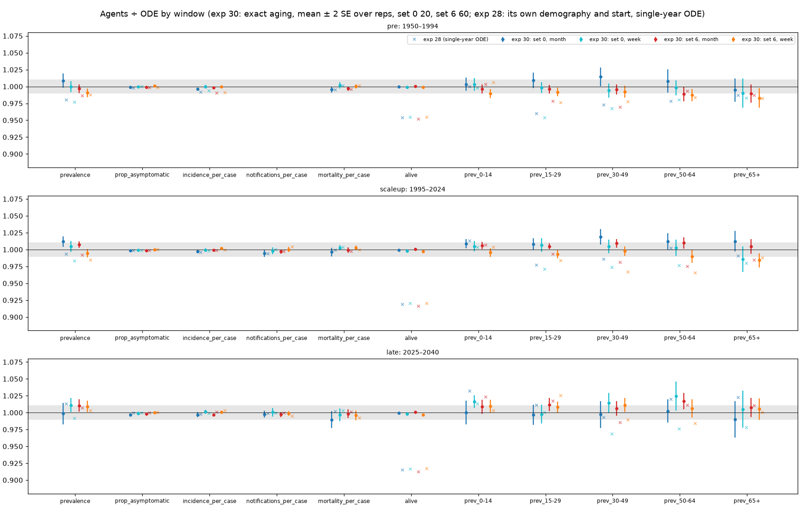
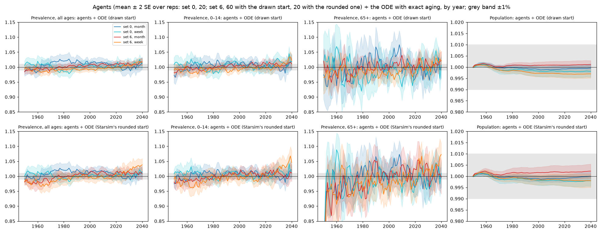

# 30: Summary

**Track:** v4 (tbsim `619c296`, starsim `d83f4f87`; `versions.json`). Run on zebra on 2026-11-19. Zebra's checkout held only the files this experiment uses, checked out from commit `67097df` with `run.py` copied over for the agents' rerun (below), so `versions.json` records its older commit, `e486c48`, as dirty.

**Question:** with the corrected demography and a starting state with ages, do v4's agents match its ODE with exp 28's TB model and treatment: in all-age prevalence, ratios per prevalent case, and prevalence by age group?

**Setting:**

- **The TB model:** exp 27's `tbode4.TBTreat`, at exp 24's sets 0 and 6. This is v4's TB model with two latent states and every reinfection risk at π, mixing homogeneously; treatment is a fixed 6-month course from the end of 1994, with coverage, efficacy and TB mortality varying over time. The rates are the same at every age.
- **Demography** ([CONVENTIONS.md 10](../../CONVENTIONS.md#10-demography-births-ages-and-the-starting-population)): India's WPP 2024 rates.
  - **Agents:** `ss.Pregnancy` with fertility shifted younger by its mean gestation, the steady-state share pregnant at the start, and births 48.63% girls.
  - **The ODE:** WPP's split by sex within each age group, and age groups of a year, a quarter and an eighth of a year. Exact aging is extrapolated as 2 × eighth − quarter (exp 29).
- **The start:** both solvers begin in 1950 from one table of TB state shares by single year of age and sex. It comes from the ODE's untreated steady state at 1950's demography, frozen for 200 years (no group's share moved by more than 3e-6 over the last 20).
- **Agents:** 100,000 at the start, monthly and weekly steps, 1950–2040: 20 reps for set 0 and 60 for set 6. Set 6's first 20 reps showed a 2% excess at weekly steps in 2025–40, and 40 more with new seeds showed it was chance.
- **Windows:** 1950–1994 (before treatment), 1995–2024 (the scale-up) and 2025–2040.

**Result:** agents match the ODE with exact aging closely.

- **Population:** within 0.3% in every window.
- **Ratios per prevalent case:** within 0.4% (incidence, notifications, the number on treatment, TB mortality, the share asymptomatic), apart from TB mortality per case for set 0 at monthly steps in 2025–40 (0.990 ± 0.006).
- **All-age prevalence:** within 1.2% in every window, set and step (0.991–1.012).
- **Prevalence by age group:** within 2.4% in every window, set and step.

In exp 28, before the demography was corrected and with an age-independent start, population was 5–9% off and prevalence by age group up to 10% off.

Getting there needed a fix to how Starsim's agents take a starting state by age (Finding 3).

## Finding 1: population, ratios per case and prevalence by age match the exactly aged ODE

| Agents ÷ ODE with exact aging (mean ± SE over reps of window means of yearly values; set 0, 20 reps; set 6, 60) | Set 0, month | Set 0, week | Set 6, month | Set 6, week |
|---|---|---|---|---|
| Prevalence, 1950–94 | 1.009 ± 0.005 | 1.000 ± 0.004 | 0.997 ± 0.003 | 0.991 ± 0.003 |
| Prevalence, 1995–2024 | 1.012 ± 0.004 | 1.005 ± 0.004 | 1.007 ± 0.002 | 0.995 ± 0.003 |
| Prevalence, 2025–40 | 0.999 ± 0.008 | 1.011 ± 0.005 | 1.010 ± 0.005 | 1.009 ± 0.004 |
| Incidence per case, all windows | 0.996–0.997 | 0.999–1.001 | 0.997–0.999 | 1.000–1.002 |
| Notifications per case, from 1995 | 0.994–0.998 | 0.998–1.001 | 0.997 | 0.999–1.000 |
| TB mortality per case, all windows | 0.990–0.996 | 0.997–1.003 | 0.997–0.999 | 0.996–1.002 |
| Population, all windows | 0.999–1.000 | 0.998–0.999 | 1.001 | 0.997–0.999 |
| Prevalence by age group (five groups × three windows) | 0.990–1.019 | 0.986–1.024 | 0.989–1.017 | 0.983–1.011 |

- **What the design asked:** within about 1% and 2 SE at weekly steps in the two later windows.
  - **Ratios per prevalent case and population pass.**
  - **All-age prevalence passes or is just outside:** 1.005 ± 0.004 and 1.011 ± 0.005 for set 0; 0.995 ± 0.003 and 1.009 ± 0.004 for set 6.
  - **Prevalence by age group** is within the design's 2% in all but one cell: set 0, 50–64, 2025–40, 1.024 ± 0.011 (20 reps).
- **Set 6's first 20 reps** gave 1.021 ± 0.009 at weekly steps in 2025–40, the only window outside 1.2%. That's in every age group alike, so it was in the level of the epidemic, not its age pattern. 40 more reps with new seeds give 1.003 ± 0.004 (60 reps together: 1.009 ± 0.004), so it was chance. The runs with Starsim's rounded start (Finding 3) had shown the same excess, but they used the same seeds.
- **Differences of about 1% remain, now resolved by set 6's 60 reps:** 1.007 ± 0.002 at monthly steps in 1995–2024, and 0.991 ± 0.003 at weekly steps before 1995. They're within the design's 1%, and as large as exp 27's without demography (0.997–1.008). Not pursued. Before 1995 they may include settling from the start; at monthly steps, agents also drift by about 1% from the ODE's starting state (exp 27).
- **Recent latent infection reads high** in agents (×1.03–1.14 weekly and ×1.16–1.63 monthly). That's the end-of-step snapshot effect (exps 21, 28), and remote latent infection and the cleared share match within 2%.
- **Treatment pitfall checks are as in exps 27–28** (`pitfall_checks.csv`, 310,000 courses per step for set 0, and 880,000–890,000 for set 6). At monthly steps there were 16 and 35 starts while on treatment, and 4 and 7 TB deaths on courses that will cure (set 0, set 6); at weekly steps, 0–1. Exp 23 traced such cases to a cure, relapse and restart, or a death within one step, which continuous time allows. Nobody starts treatment unless symptomatic, and nobody relapses without a cure.

## Finding 2: the ODE's age groups still matter with TB

| The ODE ÷ the ODE with exact aging (deterministic; range over sets, steps and windows) | Population | All-age prevalence | Prevalence by age group |
|---|---|---|---|
| Single years | 1.012–1.019 | 1.000–1.006 | 0.984–1.027 |
| Quarter-year | 1.003–1.005 | 1.000–1.001 | 0.996–1.007 |
| Eighth-year | 1.002–1.003 | 1.000–1.001 | 0.998–1.004 |

- **Single years overstate population by 1.2–1.9%,** as in exp 29 without TB. All-age prevalence barely moves, but prevalence by age group is off by up to 2.7% (15–29 and 30–49). That's because aging between groups moves people, with their TB states, to older ages too soon.
- **Against the single-year ODE,** agents' population is 0.979–0.990, and prevalence by age group 0.972–1.033 (`by_window_single.csv`).
- **Quarter-year groups are within 0.5% of exact aging,** and eighth-year within 0.3%. With TB, one weekly run took 22–23 s with single years, 27–33 s with quarter-year groups and 44–45 s with eighth-year groups (1950–2040, one core).

## Finding 3: Starsim's agents round each starting state to whole agents in each age group, which loses rare states in small groups

- **What happens:** in v4's agent solver, a starting share given by group (`init=` with `ss.by`) becomes an exact count in each age and sex group: round(share × agents in the group), keeping the group's total. Starsim does this so that agents start as the compartmental solver does.
- **Why it matters here:** with single years of age by sex and 100,000 agents, the groups at older ages hold about 50–150 agents each. Active TB is 0.2–0.35% for each of its two states, and recent infection and susceptibility are as rare at those ages. Their expected counts are below 1 in each such group, so they mostly round to nobody.
- **The effect:** agents' 65+ prevalence in 1950 was 0.49–0.73 of the ODE's (mean of 20 reps), the same count in every seed. It was 0.95–0.99 for 65+ over 1950–94, and recovered over the following decades (`ratio_over_time.png`, bottom row). Younger groups are large, so they were unaffected.
- **The fix:** while agents' TB states are set at the start, each group's counts are drawn from a multinomial, seeded by the run's seed (`_drawn_start` in `run.py`). In distribution, that's the same as drawing each agent's state from its row of the table. With it:
  - 65+ prevalence in 1950 is 0.97–1.02 ± 0.02–0.05;
  - every state matches the table at every age within noise, with 100,000 or 400,000 agents (checked at the start, 8 seeds);
  - population is unchanged (0.9989 ± 0.0019 of the ODE's in 1990, 8 reps).

  The agent runs were rerun with it, with the same seeds (set 6's extra 40 reps all use it). The 20 reps per set and step with the rounded start are kept (`runs_rounded.obj`, `by_window_rounded.csv`).
- **Two more Starsim behaviours with starting states by age,** found in the quick test and avoided by the design:
  - agents given a table finer than their own age groups start with wrong shares when several states are given (most adults susceptible, with WPP's age groups and an eighth-year table);
  - agents refuse a share by group for every state, susceptible included ("the initial values sum to 0"), though the ODE accepts it. Leaving susceptible to take the rest works in both.
- **How the design avoids them:** both solvers start from one table by single year of age, with agents stratified by single years (which only affects their results and how they read the table), and every state given but susceptible.

## What this means

- **The demography row is matched:** with CONVENTIONS.md 10's settings, a start with ages and the drawn start, agents and the ODE agree with TB, treatment and India's demography. Population is within 0.3%, ratios per case within 0.4%, prevalence within 1.2% overall and 2.4% by age group.
- **For our setup:**
  - **The ODE:** quarter-year age groups, the convention (0.3–0.5% from exact aging in population, about 30 s per weekly run with TB; CONVENTIONS.md 10), with eighth-year ones (0.2–0.3%, about 45 s) added for extrapolation when a comparison needs better. Single years are 1.2–1.9% off in population and up to 2.7% in prevalence by age.
  - **Starting states by age:** one table by single year of age and sex for both solvers, every state but susceptible; agents stratified by single years, and their counts drawn rather than rounded (CONVENTIONS.md 10).
- **For Starsim:** [proposal 07](../../proposals/07_starting_states/proposal.md) (draft) reports the rounded start and the two other behaviours, which share one cause: a table read per agent draws the states one at a time. The rounding is a design choice, but it biases rare states down in small groups; drawn counts, or a stochastic rounding, would keep them right on average.
- **Next:** recalibration with demography (exp 28 found it raises the ODE's burden 1.35–1.6× at these parameters).

## Files

- `run.py`: its starting-state code and drawn start are now `tbode4.start` (`settled_start()`, `use_drawn_start()`; identical tables and agents for the same seed); `run.py` keeps its own copy. Steps: `check` (the quick test of the starting state), `timing`, `start`, `tb` (ODE, then agents), `agents` (agents only), `more` (extra reps for set 6, merged into `runs.obj`), `summary` (tables and figures). The quick test of every step is in `quick/`.
- `start.obj`: the two starting states (each state's share by single year of age and sex, the frozen run's drift, the share of non-infectious people already asymptomatic).
- `ode.obj`: the ODE at each width, set and step. `runs.obj`: agents with the drawn start. `runs_rounded.obj`: the first agent runs, with Starsim's rounded start.
- `summary.log`: every table, including exp 28's for comparison. `by_window.csv` (against exact aging), `by_window_single.csv` (against single years), `by_window_rounded.csv`, `ode_widths.csv`, `pitfall_checks.csv`.
- Figures: `by_window.png`, `ratio_over_time.png`, `tb_burden_set<i>.png` and `tb_prev_by_age_set<i>.png` (agents' reps and mean, the exactly aged ODE and the single-year one).
- Logs: `tb.out` (start, ODE, first agent runs), `agents.out` (agents' rerun), `more.out` (set 6's extra reps). `versions.json`.
