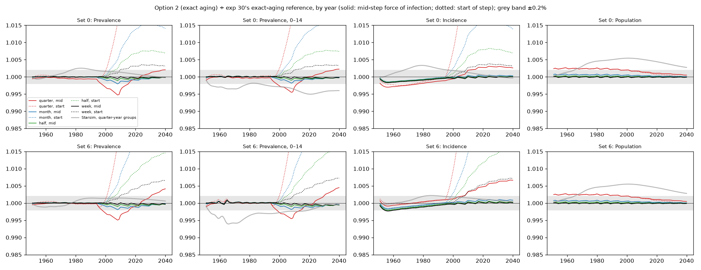

# 31: Summary

**Track:** v4 (tbsim `619c296`, starsim `d83f4f87`; `versions.json`). Run on the laptop (4 cores) on 2026-11-20.

**Question:** can a standalone ODE with ages and demography reproduce v4's ODE (exp 30) and its exact-aging limit quickly enough for IMIS, and with exact aging, which time step is accurate enough?

**Setting:**

- **The model:** `tbode4.fastode_age`. Its TB model and treatment are `fastode`'s (exp 24's calibrated model). Its demography is exp 30's: India's WPP 2024 rates from 1950, births as female as the 1950 population, and no replacement of TB deaths.
- **Two ways of aging:**
  - **Option 1, `run_rate()`:** a copy of v4's ODE, with quarter-year groups aged out at a constant rate, solved in continuous time, and the 6-month course as 12 Erlang stages.
  - **Option 2, `run_cohort()`:** exact aging. Groups are one step h wide and shift up one group each step. TB transitions use one matrix exponential per step for all ages, with the force of infection at mid-step (a predictor-corrector) or at the step's start. The course is a conveyor of whole steps, as in Starsim's ODE.
- **Parameter sets:** exp 24's sets 0 and 6 (exp 27's sets file), with treatment, 1950–2041. They start from exp 30's starting tables unless the arm builds its own.
- **Exact aging, the reference:** exp 30's 2 × eighth-year − quarter-year Starsim ODE at weekly steps.
- **Statistics:** every run is deterministic. Ratios are of window means of yearly means (1950–94, 1995–2024, 2025–40), and the largest |ratio − 1| in any single year from 1951.

**Result:** yes. Option 2 at monthly steps, with the force of infection at mid-step and a 100-year start, takes about 1.1 s per draw. It is within 0.1% of exact aging in every window, output and age group, and within 0.06% of its own weekly-step results on every calibration target, at both sets and at 20 prior draws. A 310,000-draw IMIS run would take about a day on the laptop's 4 cores.

## Finding 1: the copy reproduces v4's ODE

| Option 1 ÷ Starsim's quarter-year ODE, on Starsim's own grid (largest over sets 0 and 6) | Monthly | Weekly |
|---|---|---|
| Population, any year | 0.00% | 0.03% |
| Prevalence, all ages, any year | 0.06% | 0.07% |
| Prevalence by age group, any year | 0.15% | 0.10% |
| TB mortality, any year | 0.07% | 0.09% |
| Notifications, window means | 0.07% | 0.03% |
| Incidence, before 1995 (window) | −0.11% to −0.14% | the same |

- **The TB, treatment and demography equations are right.** Population, prevalence, mortality and prevalence by age agree with Starsim's ODE within 0.15% in every year, at both of Starsim's steps (`copy.csv`).
- **The rest is expected:**
  - **Incidence before 1995** is 0.1% higher in Starsim's ODE. Exp 30's `ode_incidence` rebuilds first entries by decaying NON0 at the mean death rate over ages, while `fastode_age` tracks NON0 by age. The offset is the same at every step of option 2 too (Finding 2).
  - **The number on treatment** differs by up to 2.7% in 1995–96, while treatment rises from zero. Its window means differ by under 0.35%. This is the 12 Erlang stages against Starsim's exact course.
- **The design expected the copy to be closer to Starsim's weekly run than its monthly run.** It is about equally close to both. Starsim's monthly and weekly runs, compared as yearly means, differ by up to 0.2%, but most of that is a property of yearly means, not of the ODE (Finding 2).
- **Run time:** 1.5–2.8 s, against Starsim's 7 s at monthly steps (on zebra).

## Finding 2: exact aging by cohort converges to exact aging, at second order with the mid-step force of infection

**Against exp 30's exact-aging reference** (yearly means; ranges over sets 0 and 6):

| Option 2 ÷ exact-aging reference | Quarter-year, mid | Monthly, mid | Monthly, start of step | Weekly, mid |
|---|---|---|---|---|
| Population, any year | 0.27% | 0.09% | 0.09% | 0.02% |
| Prevalence, window means | 0.997–1.002 | 0.999–1.000 | 1.000–1.026 | 1.000 |
| Prevalence, any year | 0.53% | 0.20% | 3.0% | 0.05% |
| Prevalence by age group, any year | 0.56% | 0.21% | 3.6% | 0.11% |
| Incidence, TB mortality and notifications, window means | 0.998–1.006 | 0.999–1.001 | 0.999–1.030 | 0.999–1.000 |

**Against itself at weekly steps** (the calendar summary: stocks on 1 January, flows totalled over each calendar year), the largest deviation in any year and any output, number on treatment included (range over sets 0 and 6):

| | Quarter-year | Monthly | Half-month (1/24) |
|---|---|---|---|
| Mid-step force of infection | 0.67–0.74% | 0.07–0.08% | 0.01–0.02% |
| Force of infection at the step's start | 6.5–11.7% | 2.1–3.7% | 1.0–1.8% |

- **The mid-step version converges at second order:** its prevalence error falls about 10× from quarter-year to monthly steps (3× smaller), and 3–6× from monthly to half-month steps (2× smaller). The start-of-step version converges at first order (2× per halving).
- **Its limit is exact aging:** extrapolated from its half-month and weekly runs, option 2 is within 0.05% of exp 30's reference in every window and age group.
  - **Two remaining gaps are the reference's:** incidence before 1995 (the approximate first-entry count), and the number on treatment, 0.23% more than Starsim's weekly runs. Starsim's weekly course is 26 steps of 7 days, 0.498 years.
- **Calibration targets** (exp 24's, with prevalence at 15+) at monthly steps, mid-step, are within 0.03% of weekly at both sets (`steps_targets.csv`). At quarter-year steps they're within 0.35%. With the start-of-step force of infection, 2020 prevalence is 1.5–1.9% high at monthly steps.
- **Yearly means depend on the step when outputs change fast.** Exp 28's yearly means average each step's end-of-step value. At monthly steps these sit on average a half-step (0.03 years) later than at weekly steps. In a scale-up where prevalence falls 12% a year, that's 0.4% in the yearly mean, with the model itself the same on 1 January (within 0.04%). So steps are compared with the calendar summary (`fastode_age.calendar()`). Comparisons with Starsim's ODE and with agents keep yearly means, as exp 30 saved them.
- **Three fixes were needed** to make the cohort step second order (README, Design). Each was found as an error that halved with the step:
  - rates by age taken as the mean of a group's own and the next group's, since a group ages one width during the step: population had been 1.2% low by 2020 at monthly steps;
  - newborns given half a step of TB transitions: 0–14 prevalence had been 0.3% low;
  - the step's births counted in the predicted end-of-step population, the force of infection's denominator: prevalence had been 0.35% high.

## Finding 3: `fastode_age` can make its own starting table, and 100 years is enough

| Monthly option 2, from its own table ÷ from exp 30's table | Set 0 | Set 6 |
|---|---|---|
| Prevalence, 1950–94 window (200 / 100 / 50 years) | 0.999 / 0.999 / 1.001 | 0.999 / 0.999 / 1.007 |
| Prevalence, 1995–2040 windows (200 or 100 years) | 1.000 | 1.000 |
| Every target, 200 or 100 years | 1.0000 | 1.0000–1.0001 |
| Targets, 100 years ÷ 200 years | within 0.001% | within 0.002% |
| Targets, 50 years ÷ 200 years | within 0.001% | within 0.05% |
| Largest change in any group's share over the last 20 years (200 / 100 / 50 years) | 4e-8 / 4e-4 / 3e-2 | 3e-6 / 3e-3 / 8e-2 |

- **Its tables differ from exp 30's mostly in the first year of age,** by up to 0.007 in a share: exp 30's frozen run aged people at a constant rate (eighth-year groups), which spreads infants' ages and so their exposure. At ages 1 and over, the largest difference is 0.003–0.004.
- **The difference fades by 1995:** prevalence is 0.1% lower over 1950–94 (up to 0.2% in single early years, incidence 0.3%), and the same to 1e-4 from 1995 on, and in every target.
- **A 100-year frozen run** gives the same targets as 200 years to 0.002% at half the cost (0.57 s). 50 years doesn't settle set 6 (prevalence +0.7% before 1995).

## Finding 4: the monthly step holds across the prior

- **The draws:** 20 draws from exp 24's priors with an untreated endemic equilibrium (37 tried), with 2020 prevalence from 34 to 14,900 per 100,000. Each was run as the calibration would run it: a 200-year frozen start, then 1950–2041, all at one step.
- **Monthly ÷ weekly:** every target within 0.06%, and every output in the calendar summary within 0.18% in every year (`prior.csv`).
- **Quarter-year ÷ weekly:** targets within 0.6%, and outputs up to 1.1% in single years (11 of 20 draws above 0.2%).
- **All 20 frozen runs** kept an endemic state at India's 1950 demography at every step.

## Finding 5: against agents, as exp 30's ODE was; the start-of-step force of infection doesn't explain monthly agents' offset

| Exp 30's agents (mean ± SE; set 0, 20 reps; set 6, 60) ÷ the model, prevalence, 2025–40 | Set 0, monthly agents | Set 0, weekly agents | Set 6, monthly agents | Set 6, weekly agents |
|---|---|---|---|---|
| Exp 30's exact-aging reference | 0.998 ± 0.008 | 1.011 ± 0.005 | 1.009 ± 0.005 | 1.009 ± 0.004 |
| Option 2, monthly, mid-step | 0.998 ± 0.008 | 1.012 ± 0.005 | 1.010 ± 0.005 | 1.010 ± 0.004 |
| Option 2, monthly, start of step | 0.983 ± 0.008 | 0.996 ± 0.005 | 0.983 ± 0.004 | 0.983 ± 0.004 |

- **The sanity link holds:** agents ÷ option 2 at monthly steps (mid-step) is within 0.002 of agents ÷ exp 30's reference, for prevalence, ratios per case and population, in every window, set and step (`agents.csv`).
- **The possible explanation doesn't hold:** with the force of infection at the step's start, monthly option 2 runs 1.7% higher than agents in 2025–40 in three of the four columns. Monthly agents also take infection from the step's start, so this was a candidate for their slow settling (exp 27). Agents don't show that excess, so the start-of-step force of infection isn't the explanation. It stays unexplained (README, "Known unexplained differences in v4").

## Run time

Median run times on one laptop core:

| | Quarter-year | Monthly | Weekly (1/52) |
|---|---|---|---|
| 1950–2041 | 0.1 s | 0.5 s | 14 s |
| Frozen start, 100 years | — | 0.57 s | — |
| The whole draw, with a 200-year start (arm P) | 0.4 s | 2.0 s | 58 s |

- **A draw at monthly steps with a 100-year start:** about 1.1 s. A 310,000-draw IMIS run (exp 24's size) is then about 24 hours on 4 cores, or about 40 minutes on zebra's 160.
- **Against Starsim's quarter-year ODE:** about 15 s per draw (7 s for 1950–2041 and up to 11 s for the start, on zebra, not the laptop), so `fastode_age` is roughly 14× faster at monthly steps.
- **Quarter-year steps** would be under 0.4 s per draw, but put targets up to 0.6% off at prior draws and single years up to 1.1%.

## What this means

- **For the recalibration:** use `fastode_age.run_cohort()` at monthly steps with the mid-step force of infection, and a 100-year frozen start per draw (`settle(years=100)`, then `start_table()`). The step adds under 0.1% to the calibration targets, against their σ of about 10%. Only the start-of-step version of the force of infection is ruled out.
- **The design's criteria:**
  - **The copy:** met (Finding 1), though not by being closer to Starsim's weekly run than its monthly run.
  - **Convergence and the limit:** met (Finding 2).
  - **The step:** monthly steps are within 0.2% of weekly, at both sets and at the prior draws (Findings 2 and 4).
  - **The start:** 100 years is within 0.05% of the 200-year start's targets (Finding 3).
  - **Speed:** about 1 s per draw.
- **Its cost on the laptop is borderline:** about a day per IMIS run, and three runs for exp 24's protocol (re-identification, real targets, second seed). On zebra it's about 40 minutes per run.
- **Kept as checks:** `v4/tests/test_fastode_age.py` runs v4's ODE live against option 1 (within 0.1% before 1995, 0.2% after), checks that option 2 at monthly steps is within 0.2% of half-month steps, and checks the starting table's round trip. Rerun it after bumping the v4 pins.

## Files

- **Code:** `v4/tbode4/fastode_age.py` (the model); `run.py`: `copy`, `steps`, `start`, `prior`, `summary`.
- **Raw runs:** `copy.obj`, `steps.obj`, `start.obj`, `prior.obj` (yearly means, the calendar summary, targets and run times for each run).
- **Tables:** `summary.log` (every table), `copy.csv`, `steps.csv`, `steps_targets.csv`, `start.csv`, `prior.csv`, `agents.csv`.
- **Figure:** `steps.png`.
- **Logs and versions:** `runs.out`, `versions.json`.
