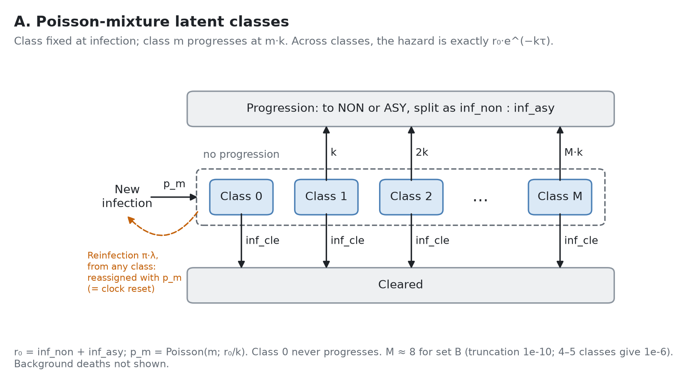
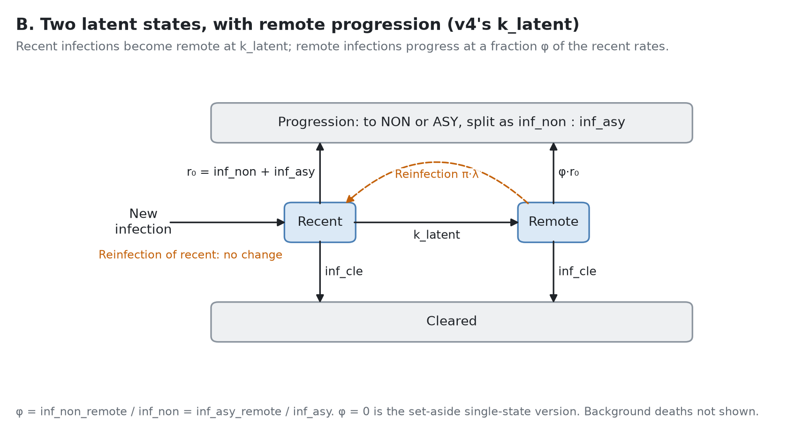
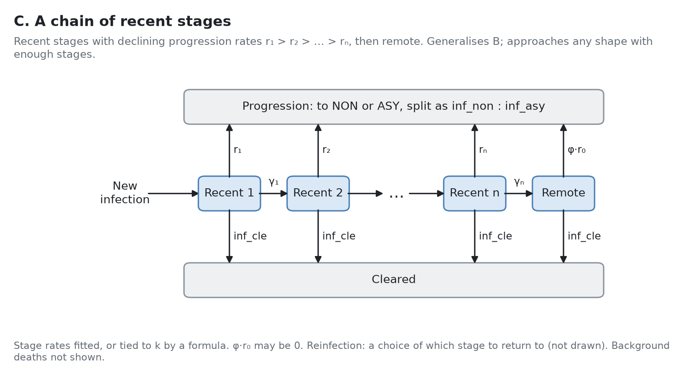
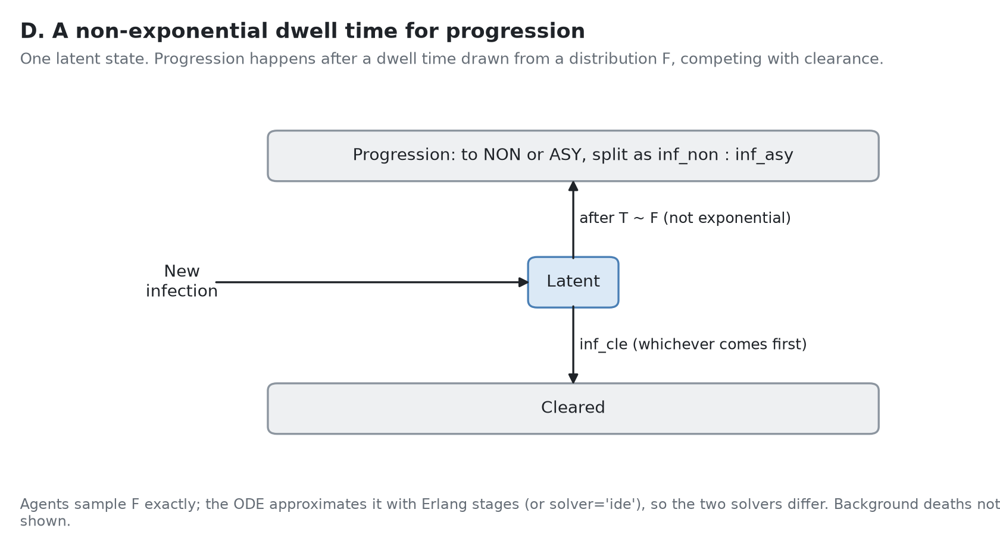

# Latent progression and reinfection in v4: options

*A comparison of the options, and the tentative decision taken from it. Sources:*

- *[Exp 16](../../experiments/16_two_state_vs_lai_tpt/SUMMARY.md): the two-state model with remote progression, against tb_LAI_TPT as run.*
- *[Exp 14](../../experiments/14_posterior_progression/SUMMARY.md) and [`compare_structures.py`](compare_structures.py) (results in `compare_structures.json`): the two-state model without remote progression, against the exact model.*
- *Cliff's v4 redo ([`v4/v4_findings.qmd`](../../v4/v4_findings.qmd)), confirmed at pinned versions in exp 13: exactness under both solvers.*
- *[`check_strains.py`](check_strains.py) (v4 track; results in `check_strains.json`, versions in `versions.json`): how v4 handles latent reinfection with strains.*
- *[`diagrams.py`](diagrams.py): the diagram under each candidate (`diagram_*.png` / `.svg`).*

*Which parameter sets:*

- *Exp 16's fit to the targets is across all 345 of tb_LAI_TPT's posterior samples.*
- *Its dynamics are across the 12 sets tb_LAI_TPT's face-validity checks use. These are the 12 most likely samples (the posterior file is sorted by log-likelihood, best first), not a representative draw. Their `sample_weight` is renormalised over the 12, as tb_LAI_TPT does. Together they hold 34% of the posterior's weight, and the top two hold 45% of the renormalised weight (25% and 20%).*
- *Results for one set are for set B, tb_LAI_TPT's best-fit natural history (row 0, `k` = 5.846), which exps 08–13 and `compare_structures.py` used as their reference.*

## What has to be decided

tb_LAI_TPT (on tbsim v0.10) makes progression from latent infection front-loaded. The rates to non-infectious and asymptomatic TB decline as r·e^(−kτ) with time since infection τ, and reinfection resets τ to 0.

tbsim v4 replaced this with `k_latent`: two latent states, recent and remote, with constant rates. Reinfection moves a remote infection back to recent, and does nothing to a recent one. We want a structure for v4 that the ODE and agents both run, and that is consistent with the earlier work. This note compares the candidates against six criteria.

## Decision (tentative)

**Option B, v4's two latent states with progression from the remote state, for now** (user, 2026-11-05). Against the criteria:

- **1. Fit to the data, which matters most:** B meets the progression targets within tb_LAI_TPT's priors: ≥ 92% of the posterior weight is within 1σ of both up to φ = 0.01, with the active-disease cascade fixed. A would need recalibrating too: at tb_LAI_TPT's parameters, it meets them for 26%.
- **2. Consistency with tb_LAI_TPT as run, which matters less:**
  - **A** has tb_LAI_TPT's hazard.
  - **B's cumulative progression** is within 2–6% for φ ≤ 0.03, against tb_LAI_TPT's curves as it measures them (end-of-step snapshots). Counted from transitions, tb_LAI_TPT as run progresses more, and B is 4–15% below it, mostly from v0.10's monthly step (exp 17).
  - **B's latent infection behaves differently:** a lifelong floor in the hazard at φ·r₀, and more of the later progression coming from latent infection.
- **3–6:**
  - B is exact under both solvers and already in v4, with strains.
  - It is smaller: 2 latent states against 8, or 30 compartments against 120 with tb_LAI_TPT's 2 drugs.
  - Its reinfection rule doesn't reset recent infections. With φ = 0.003–0.03, latent reinfection adds 83–93% as much progression as tb_LAI_TPT's model solved exactly (continuous time), and 75–84% as much as tb_LAI_TPT as run (v0.10, monthly `dt`). At set B's force of infection that's about 0.5% of cumulative progression (exp 17).

**What could reopen it:**

- the full recalibration, with φ calibrated, can't fit the data within tb_LAI_TPT's priors;
- the reinfection rule matters at equilibrium, with tb_LAI_TPT's network, demography and treatment (in a cohort it doesn't: exp 17);
- an intervention being modelled turns out to depend on how latent infection behaves, for example TPT given to latent infection only;
- B's underlying behaviour lacks face validity, especially against the underlying dynamics of tb_LAI_TPT as run (criterion 2). Examples are the latent hazard, where later progression comes from, and how long infections stay latent.

## Criteria

1. **Fit to the data** (weighted most). Does it fit the data within tb_LAI_TPT's priors?
   - **So far, the data** are the progression targets: ProgressionY1 = B(1) = 0.0523 and ProgressionRatio = B(1)/B(10) = 0.663, where B(t) is the share of a latent cohort that has ever reached asymptomatic TB. The targets come from household-contact studies (Ferebee 1970, Sutherland 1968).
   - **Later, the epidemiological targets:** the full recalibration adds them, and they respond to progression beyond the targets' 10 years.
2. **Consistency with tb_LAI_TPT as run** (weighted less). How close are its dynamics to tb_LAI_TPT's: cumulative progression, the latent hazard, and where later progression comes from?
   - **The reference** is v0.10's `tbsim.TB` at monthly `dt`, not the exact r·e^(−kτ) model. v0.10 applies each month's start-of-step hazard for the whole month, which overstates early progression (exp 08). tb_LAI_TPT computed its targets, and calibrated, with that bias.
   - **How much that matters:** the exact model with tb_LAI_TPT's parameters gives 8% less lifetime progression than tb_LAI_TPT as run (exp 16).
3. **Reinfection.** Should a reinfection reset the clock (as in v0.10), or something else? How much does the choice change outcomes?
4. **Exactness under both solvers.** Can the ODE and agents run the same model with no approximation?
5. **Size and identifiability.** How many compartments it adds (multiplied by any stratification, e.g. age, and by the sets of strains with drug resistance), and how many parameters a calibration has to identify.
6. **Multiple strains.** Does it carry over to the drug-resistance model, where superinfection of a latent infection with another strain is latent reinfection by another name? What does it keep of v0.10's rules there? See [With multiple strains](#with-multiple-strains-drug-resistance).

**Constraints from the user (2026-11-04):**

- The structure must be genuinely multi-state, not one that amounts to a single latent state.
- Parameters should stay within tb_LAI_TPT's priors where possible.

## Candidates

### A. Poisson-mixture latent classes (exact r·e^(−kτ))

A new infection joins class m with probability Poisson(m; r₀/k), r₀ = `inf_non` + `inf_asy`, and progresses at the constant rate m·k. Class 0 never progresses.

- **Consistency with tb_LAI_TPT:** the same hazard, r·e^(−kτ), for any `k`. It declines to about 0 within 2 years.
- **Fit to the data: tb_LAI_TPT's posterior doesn't carry over as is.** It was fitted with v0.10's monthly bias. Computed exactly at the same parameters, it meets both targets within 1σ for 26% of the posterior weight, against 47% as run. Lifetime progression B(50) is ×0.92 of tb_LAI_TPT as run (12 sets, exp 16). So the classes would need recalibrating in v4 too, although `k` keeps its meaning.
- **Reinfection:** a reinfected latent person is reassigned across the classes with the same weights. That is exactly a clock reset.
- **Solvers:** exact under both. Cliff declared it in v4 as an ordinary model, `TBClasses` (about 60 lines). Agents match the ODE: set B 1.003 ± 0.008 / 0.993 ± 0.004 at monthly / weekly `dt` (exp 13, 40 / 200 reps).
- **Size:** 8 latent states for set B at a truncation of 1e-10 (4–5 are enough to 1e-6), against 2 for B. One parameter, `k`, as in v0.10.
- **Interpretation.** It is a mixture of people who will and won't progress, rather than one person whose rate declines. The two are indistinguishable in every distribution of progression times, with or without reinfection.

### B. v4's two states, with progression from the remote state

Recent infections progress at `inf_non` / `inf_asy` and become remote at rate `k_latent`. Remote infections progress at a fraction φ of the recent rates and clear at `inf_cle`, as recent ones do:

| From | To NON | To ASY | To remote | To cleared |
|---|---|---|---|---|
| Recent | `inf_non` | `inf_asy` | `k_latent` | `inf_cle` |
| Remote | `inf_non_remote` = φ · `inf_non` | `inf_asy_remote` = φ · `inf_asy` | — | `inf_cle` |

- **Hazard:** among people still latent, the progression hazard steps down from r₀ to a lifelong floor of φ·r₀, rather than declining to 0.
- **Fit to the data (exp 16, fitted to the progression target means within tb_LAI_TPT's priors):**
  - **Cascade fixed** at each posterior sample's values: both targets within 1σ for ≥ 92% of the weight up to φ = 0.01, 74% at 0.03 and 46% at 0.1. Remote progression adds progression after year 1, which pulls ProgressionRatio down.
  - **`inf_cle`, `non_rec` and `non_asy` also free within their priors:** ≥ 96% up to φ = 0.1. It gets there by raising clearance: at φ = 0.1, `inf_cle` is ×1.34 the sample's value (weighted median), with 30% of the weight at the prior bound of 1.5.
- **Consistency with tb_LAI_TPT as run** (cascade fixed, φ ≤ 0.03; 12 sets, weighted means; table below):
  - **Cumulative progression is close:** B(50) ×1.00–1.03, any progression A(50) ×0.94–0.98, symptomatic C(50) ×0.97–1.00.
  - **Latent infection behaves differently.** 27–35% of the progression in years 1–10 comes from people still latent at year 1, against 12.5% as run, where most of it comes through non-infectious TB. That matters for interventions on latent infection such as TPT. tb_LAI_TPT's TPT also acts on non-infectious TB, which limits the difference for this project.
  - **Time spent latent** is within 1%. Freeing clearance instead (arm 2) costs latent infection: ×0.70 at φ = 0.1.
- **φ isn't identified by the progression targets.** With the cascade fixed, there are three parameters (r₀, `k_latent`, φ) for two targets. The plan is to calibrate φ in the full recalibration, jointly with the epidemiological targets (user, 2026-11-04). Exp 16 suggests a prior of about 0–0.03 with the cascade fixed, or up to about 0.1 if clearance may rise.
- **Reinfection:** remote → recent. Reinfecting a recent infection does nothing, where tb_LAI_TPT's model resets the clock. Without remote progression the effect is negligible (below). With φ = 0.003–0.03, in a cohort at a constant force of infection, B's rule adds 83–93% as much progression as tb_LAI_TPT's model solved exactly (continuous time), about 0.5% of cumulative progression at set B's force of infection (exp 17).
- **Solvers:** exact under both by construction, since every rate is constant. Agents ÷ ODE measured without remote progression: set B 1.01 ± 0.01 / 1.01 ± 0.01 at monthly / weekly `dt` (exp 13, 40 reps). v4's own ODE cohort with φ = 0.03 matches the deterministic chain used in exp 16 to 2.3e-6.
- **Size:** 2 latent states. Parameters `k_latent` and φ, against `k` alone in v0.10.
- **Pitfall:** `inf_non_remote=None` means "the same as `inf_non`", so by default only progression to asymptomatic TB is front-loaded. A proposal would tie both remote rates to φ.

### Set aside: v4's two states without progression from the remote state (φ = 0)

This was the first two-state version compared (as candidates B and C in earlier drafts of this note, and in exp 14): remote rates 0, with `k_latent` = k (5.846 for set B) or refitted to ProgressionY1 (5.533).

- **Why it is set aside (user, 2026-11-04):** a remote infection never progresses, so for progression it is the same as cleared. The model is then a single latent state with clearance raised to about `inf_cle` + 0.95k, far outside tb_LAI_TPT's prior for clearance (0.5–1.5 per year). That prior is why tb_LAI_TPT needed `k` in the first place.
- **For the record, against the exact model:**
  - **Shape:** 3.8% [2.7%, 4.7%] below it with `k_latent` = k; within 0.85% [0.56%, 1.03%] refitted (largest gap over 3 months–50 years, weighted median [10%, 90%] across the posterior; exp 14).
  - **Reinfection:** remote → recent adds the same progression as a clock reset, to 0.0001 for set B and 0.0004 across the posterior (table below).

### C. A chain of recent stages (Erlang or Coxian)

Several recent stages with declining progression rates, before remote. This generalises B: with more stages it can approach any shape, including r·e^(−kτ) without a floor, or with one if the last stage progresses. It is exact under both solvers, since every rate is constant. It adds stages and parameters: either fitted rates, or rates tied to `k` by a formula. Not computed here.

### D. A non-exponential dwell time for progression

v4 lets a transition take a dwell-time distribution (`ss.Transition(..., dur=...)`). Agents sample it exactly, but the ODE approximates it with Erlang stages (or `solver='ide'`), so it fails criterion 4. It also fits poorly:

- **Defective.** Progression is defective: most people never progress, and clearance competes with it.
- **Close to exponential.** The time to progression among those who progress is close to exponential (coefficient of variation ≈ 1), which Erlang stages represent badly.

## Numbers

**Fit to the progression targets: posterior weight meeting both targets, within 1σ / 2σ** (345 samples; z = log(model ÷ target mean) ÷ σ, with σ = 0.094 for Y1 and 0.071 for the ratio; exp 16):

| Model | φ = 0 | 0.003 | 0.01 | 0.03 | 0.1 | 0.3 |
|---|---|---|---|---|---|---|
| tb_LAI_TPT as run (the calibration's own values) | 47% / 87% | | | | | |
| A. Exact, at tb_LAI_TPT's parameters (not refitted) | 26% / 68% | | | | | |
| B. Two states, cascade fixed | 97% / 100% | 95% / 100% | 92% / 99% | 74% / 97% | 46% / 65% | 18% / 30% |
| B. Two states, cascade freed within priors | 99% / 100% | 98% / 100% | 97% / 100% | 98% / 100% | 96% / 100% | 86% / 96% |

The two-state model is fitted to the targets alone; tb_LAI_TPT's calibration balanced them against the epidemiological targets, so its share is lower. φ = 0 is shown for comparison only (set aside above).

**Dynamics: no-reinfection cohort, weighted means over the 12 face-validity sets** (exp 16). Rows marked ÷ are the model ÷ tb_LAI_TPT as run, where 1.00 is a match:

| Output | tb_LAI_TPT as run | A. Exact | B, cascade fixed, φ = 0.003 | φ = 0.01 | φ = 0.03 | B, cascade freed, φ = 0.03 | φ = 0.1 |
|---|---|---|---|---|---|---|---|
| B(50), progression to ASY (÷) | 0.081 | 0.92 | 1.00 | 1.01 | 1.03 | 1.00 | 1.00 |
| A(50), any progression (÷) | 0.109 | 0.87 | 0.94 | 0.95 | 0.98 | 0.96 | 0.96 |
| C(50), symptomatic (÷) | 0.044 | 0.89 | 0.97 | 0.98 | 1.00 | 0.95 | 0.94 |
| First exit from latent to NON (÷) | 6.1% | 0.78 | 0.84 | 0.85 | 0.87 | 0.85 | 0.86 |
| Expected time spent latent (÷) | 1.24 y | 1.02 | 1.01 | 1.01 | 1.01 | 0.87 | 0.70 |
| Share of years 1–10 progression from people still latent at year 1 | 12.5% | 14.7% | 27% | 30% | 35% | 31% | 32% |
| Latent progression hazard at 5 years (per year) | ≈ 0 | 0.0003 | 0.003 | 0.006 | 0.012 | 0.014 | 0.036 |

Fewer first exits to non-infectious TB is mostly v0.10's monthly step, not the latent structure: the exact model shows it too.

**Reinfection: what each structure's reinfection rule adds, without remote progression only.** Set B, everyone latent at t = 0, with background deaths (1/70 per year) and a constant force of infection λ. People no longer infected are reinfected at π·λ (π = 0.24), as new infections. The table shows the extra share ever reaching asymptomatic TB when latent people are also reinfected at π·λ by the structure's own rule, compared with not at all:

| Structure | λ = 0.12/y (set B at 500/100k), by 10 y | by 30 y | λ = 0.60/y (5×), by 10 y | by 30 y |
|---|---|---|---|---|
| A. Exact: clock reset | +0.0035 | +0.0046 | +0.0222 | +0.0398 |
| Two states, φ = 0, `k_latent` = 5.846: remote → recent | +0.0033 | +0.0045 | +0.0216 | +0.0390 |
| Two states, φ = 0, `k_latent` refitted to 5.533 | +0.0035 | +0.0046 | +0.0223 | +0.0399 |

At φ = 0 the two reinfection rules give the same answer, to within the difference in progression itself. Under the exact model, reinfecting someone infected 2 months ago changes little, because their rate has barely fallen. Under the two-state model, those are the recent infections whose reinfection does nothing. The bulk of latent reinfection acts on long-standing infections, and both rules restart their progression risk in the same way. The argument should carry over to φ > 0, but that is not yet checked (exp 17).

## With multiple strains (drug resistance)

Resistance is a low priority in the plan. But superinfecting a latent infection with another strain is latent reinfection, so the structure chosen here has to carry over to it.

**What the target ABM does.** tb_LAI_TPT's resistance runs use v0.10's `TBResistant`, with 2 drugs (RIF, BDQ), so 4 strains, any set of which can be carried at once.

- **One clock per person.** Each person has one time since infection (`ti_infected`), whatever strains they carry.
- **Any exposure of a latent infection resets the clock,** at σ = π:
  - with a strain already carried, whose count goes up;
  - with a new strain, which is added to the set.
- **Non-infectious TB can be superinfected** at the same σ. That adds a strain but doesn't affect the clock, since those people can't return to latent infection. Asymptomatic and symptomatic TB can't be superinfected.

**What v4 does.** Strains are a dimension of the states (`ss.Strains`). A person is in one state, with one course of disease, carrying a set of strains. So in every candidate, as in v0.10, the clock belongs to the person, not to a strain.

**A. Classes.**

- **Rule:** exposure in any class, at σ·foi, reassigns the person across the classes with the Poisson weights and adds any new strain. That is v0.10's rule exactly.
- **Not declared yet.** `TBClasses` has neither latent reinfection nor strains. `tbsim.add_resistance` finds transitions by name (`latent_asy`, `clearance`, …), so it would have to be given every class's transitions.
- **Size:** classes × sets of strains. For tb_LAI_TPT's 2 drugs (15 sets), that is 8 × 15 = 120 latent compartments (5 × 15 = 75 at a truncation of 1e-6), plus M² reassignment transitions for each set.

**B. Two states.** The rules don't depend on φ.

- **Already works with drugs.** `check_strains.py` turns off superinfection of recent latent infections. After 2 years, 135 per 100k recent latent infections still carry DS+RIF, and those can only have come through `reinfect_remote`.
- **Rule:**

  | Latent state | Reinfected with | Result |
  |---|---|---|
  | Remote | any strain | → recent, with any new strain added |
  | Recent | a new strain | stays recent, with the strain added (`superinfection_infection`) |
  | Recent | the same strain | nothing |

- **What is lost, relative to v0.10:** the clock reset for recent infections, as with one strain. The strains people carry are kept. The progression hazard depends on the person's clock, not on their strains, and superinfection carries no progression penalty in tb_LAI_TPT. So the loss depends only on the total force of infection on latent people, and is the single-strain result at that total. At φ = 0 that is within 0.0004 across tb_LAI_TPT's posterior at set B's force of infection (exp 14); with φ > 0 it is still to check (exp 17).
- **Pitfall: two parameters where v0.10 has one σ.** `rr_reinfection_inf` sets the rate for remote infections, and `rr_superinfection_latent` the rate for recent ones. The latter defaults to 1.0, about 4× tb_LAI_TPT's π. So does `rr_superinfection_non`, v4's counterpart of v0.10's σ_N for non-infectious TB. To mirror tb_LAI_TPT, set all three to π; a proposal could tie them together.
- **Size:** 2 × 15 = 30 latent compartments.

**C. Stage chain.** As B, with a choice of which stage reinfection returns to. Size: stages × 15.

**D. Dwell time.** Not exact under the ODE, with or without strains.

**Lost in every option,** so they don't separate the candidates:

- **A clock for each strain.** Suppose someone with a 10-year-old DS infection is superinfected with RIF. They get a fresh, high early risk for both strains together; v0.10 does the same. A model in which only the new strain carries the early risk would need latent states for each strain × time since infection, which in practice means agents only. It's not a loss against the ABM, but the proposal should make the choice knowingly.
- **Strain counts.** v0.10 counts copies of each strain (superinfection with the same strain increments the count); v4 carries sets, without counts.
  - **Where the counts matter:** only for people carrying two or more different strains. They set which strain is transmitted (∝ count × fitness), and which progresses alone when `p_multi` < 1 (1.0 in tb_LAI_TPT's default config).
  - **Where they don't:** infectiousness, progression, clearance, treatment and acquisition of resistance.
  - **Expected size:** small, since superinfection is rare and the counts only change the strain mix within those people. Not measured.
  - **Scope:** this belongs to the resistance row, not to this decision.

## Summary against the criteria

| | A. Classes | B. Two states, with remote progression (chosen, tentatively) | Set aside: two states, φ = 0 | C. Stage chain | D. Dwell time |
|---|---|---|---|---|---|
| 1. Fit to the data (progression targets, so far) | Needs recalibrating: at tb_LAI_TPT's parameters, meets the targets for 26% of the weight (as run: 47%) | Meets them: ≥ 92% of the weight up to φ = 0.01 with the cascade fixed; ≥ 96% up to φ = 0.1 with clearance raised | Meets them (97%), but see priors | Any, with enough stages (not computed) | Poor fit |
| Within tb_LAI_TPT's priors | Yes | Yes: φ ≤ ~0.01 with the cascade fixed, ≤ ~0.1 with clearance raised | No: effective clearance ≈ `inf_cle` + 0.95k | Not checked | — |
| 2. Consistency with tb_LAI_TPT as run | Same hazard; until refitted, lifetime progression ×0.92 of as run | Cumulative progression within 2–6% (φ ≤ 0.03); latent hazard floors at φ·r₀; 27–35% of years 1–10 progression from latent infection, against 12.5% | Within ~1% of the exact model; effectively single-state | Can approach tb_LAI_TPT's hazard | — |
| 3. Reinfection | Exact clock reset | Remote → recent; recent unchanged; effect checked at φ = 0 only | Matches clock reset (to 0.0001, set B) | Choice of rule | — |
| 4. Both solvers exact | Yes | Yes | Yes | Yes | No (ODE approximates) |
| 5. Size, parameters | 8 states; `k` | 2 states; `k_latent`, φ (φ to calibrate) | 2 states; `k_latent` | 3+ states; more | 1 transition |
| 6. With strains: reinfection | v0.10's rule exactly | Recent: new strain added, no reset; remote: reset, strain added | As B | Choice of rule | — |
| 6. With strains: latent compartments (2 drugs, 15 sets) | 120 (75 at 1e-6) | 30 | 30 | 45+ | — |
| 6. With strains: reinfection parameters | One σ | Two (`rr_reinfection_inf`, `rr_superinfection_latent`); set both to π | As B | — | — |
| Late reactivation | No (rate → 0) | Yes, lifelong at φ·r₀ | No | Optional | — |
| Already in tbsim v4 | No (Cliff's `TBClasses`, without reinfection or strains) | Yes, with strains | Yes, with strains | No | Partly |

## What the decision leaves open

- **How to set φ.** It is to be calibrated eventually, but it may only be identifiable once the model is calibrated to all the targets, burden data included (user, 2026-11-05). Until then, sweep a couple of reasonable values.
  - **Range:** about 0–0.03 from exp 16, or up to about 0.1 if clearance may rise within its prior. The long-term reactivation literature could inform it.
  - **Open:** whether to let `inf_cle`, `non_rec` and `non_asy` move to make room for larger φ, at the cost of less latent infection.
- **Whether B's latent behaviour is acceptable** (criterion 2). It has a reactivation floor where tb_LAI_TPT's hazard declines to zero, and 2–3 times as much of the progression after year 1 comes from latent infection rather than non-infectious TB. Interventions on latent infection would be affected; tb_LAI_TPT's TPT also acts on non-infectious TB, which limits this.
- **Reinfection of recent infections.** Is v4's "does nothing" acceptable as a modelling statement? It makes no measurable difference at φ = 0, and with φ ≤ 0.03 it changes cumulative progression by about 0.5% at set B's force of infection (exp 17). Or should we ask for a clock reset in principle?
- **With strains: match v0.10's multistrain model where possible** (user, 2026-11-05).
  - **The parameters:** in v0.10's `TBResistant`, σ is the risk of reinfecting a latent infection, relative to someone susceptible, with the same strain or another one. It is `rr_reinfection_inf` (σ_L), and `rr_reinfection_non` (σ_N) for non-infectious TB. tb_LAI_TPT sets both to π.
  - **Matching them in v4 means setting three parameters to π:**
    - `rr_reinfection_inf` for remote infections (v4's default is 0.21);
    - `rr_superinfection_latent` for recent infections;
    - `rr_superinfection_non` for non-infectious TB.
  - **Defaults:** the last two default to 1.0, about 4× π. A wrapper or proposal could tie all three to one value.
  - **What still differs:**
    - **Reinfection of a recent infection:** with a new strain, it adds the strain and leaves the person recent; with the same strain, it does nothing. v0.10 also resets the clock. Within B, a reset would also leave the person recent, because the state has no memory. So the difference is only that B has no hazard declining within the recent state; exp 17 measures its effect.
    - **Strain counts:** v4 doesn't keep them (see above).
- **Clocks belong to the person, not the strain,** in B as in v0.10. Worth stating if this goes upstream.
